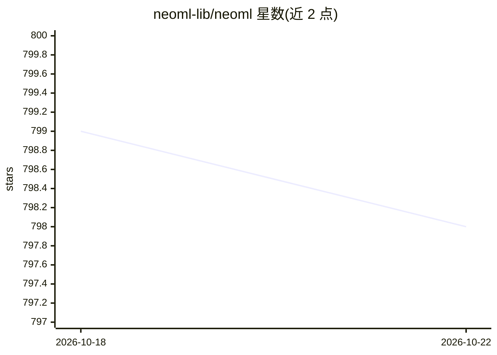

# neoml-lib/neoml

⭐ 798 · C++ · Apache-2.0 · 推送 2025-11-26 · [GitHub](https://github.com/neoml-lib/neoml) · [官网](https://www.abbyy.com/neoml/) · 组织维护

**ABBYY 的跨平台机器学习框架：构建、训练与部署深度/传统 ML 模型**

端到端机器学习框架，提供 100+ 层类型的神经网络与 20+ 传统机器学习算法（分类、回归、聚类等），支持 CPU 与 GPU 训练/推理，跨 Windows/Linux/macOS/iOS/Android 运行同一代码。接口覆盖 Python、C++、Java、Objective-C；Java 与 Objective-C 仅为推理版本。支持导入 ONNX 格式模型，但不能导出 ONNX；模型使用自有二进制序列化格式。起源于 ABBYY 内部基础设施，用于计算机视觉与 NLP 任务（OCR、文档版面分析等）。

## 筛选速览

| 维度 | 判定 | 备注 |
|---|---|---|
| AI 角色 | `ai-native` | 本体是模型或模型工具 |
| 许可风险 | `permissive` | Apache-2.0 |
| 部署形态 | `None` |  |
| 模型依赖 | — | README 未给出锁定关系 |
| 硬件要求 | — | 无带数字的原话,不猜 |
| 安装摩擦 | `high` | 编译与系统依赖俱全 |
| 成熟度 | — | 结构信号不足 |

## 能力要点

- 神经网络 100+ 层类型与传统 ML 20+ 算法
- ONNX 模型导入（不支持导出为 ONNX）
- CPU/GPU 双支持，同一代码跨 5 个平台运行
- Python/C++/Java/Objective-C 四种语言接口

## 适用场景

- 在桌面与移动端（含 iOS/Android）部署训练好的模型
- 构建并训练计算机视觉或 NLP 模型
- 在 C++ 工程中集成传统机器学习算法（梯度提升、k-means 等）

## 场景标签

`模型训练` `推理引擎` · 领域:训练与推理

## 证据(README 行号)

> L9: **NeoML** is an end-to-end machine learning framework that allows you to build, train, and deploy ML models. This fr
> L13: - Neural networks with support for over 100 layer types
> L14: - Traditional machine learning: 20+ algorithms (classification, regression, clustering, etc.)

## 星数曲线

2026-10-18 799 → 2026-10-22 798（-1）

---
*卡片 v1 · prompt 1.4 · 生成 2026-10-21 · 置信度 high · 依据 README sha `4e39eea6210a` · [字段定义](../../DATASET.md)*
