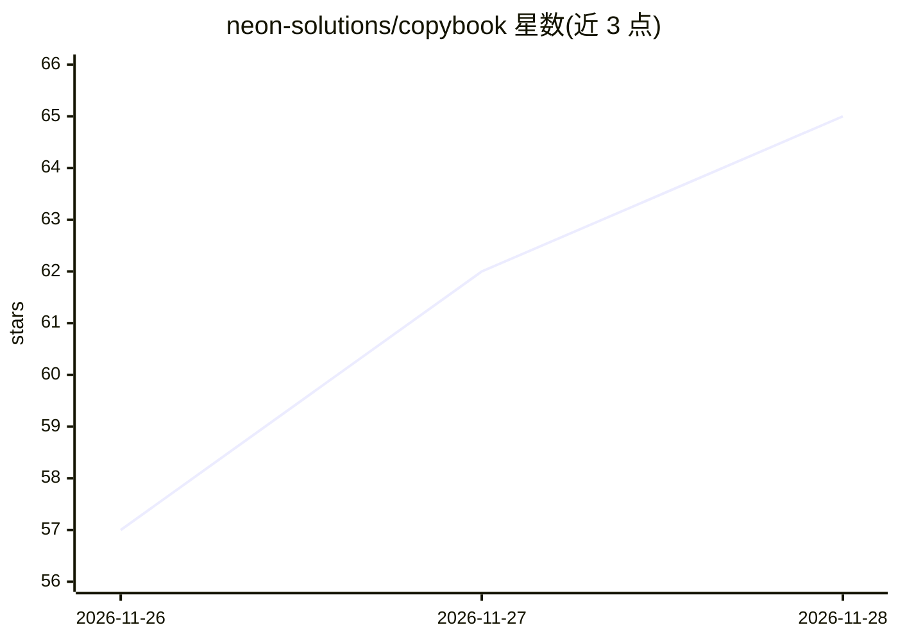

# neon-solutions/copybook

⭐ 65 · TypeScript · MIT · 推送 2026-11-24 · [GitHub](https://github.com/neon-solutions/copybook) · [官网](https://copybook.dev) · 组织维护

**为开发者管理与测试复制给用户的代码片段和 agent 提示词**

Copybook 将开发者产品中散落在组件字符串里的代码片段、命令与 agent 提示词定义为带类型与版本的定义对象，并通过 CLI 提供快照渲染、过期检查、片段解析/类型检查/运行、提示词交给编码 agent 评测、用量统计与本地浏览等命令。monorepo 含零依赖 core 包、CLI 包与 shadcn registry 组件，提供 examples/acme 示例可在无账号下运行全部命令。声明处于 0.x，minor 版本可能包含破坏性变更。

## 筛选速览

| 维度 | 判定 | 备注 |
|---|---|---|
| AI 角色 | `ai-ecosystem` | LLM/agent 周边工具 |
| 许可风险 | `permissive` | MIT |
| 部署形态 | `library` | 以包/库形式分发 |
| 模型依赖 | — | README 未给出锁定关系 |
| 硬件要求 | — | 无带数字的原话,不猜 |
| 安装摩擦 | `low` | 无编译、无系统依赖或容器化 |
| 成熟度 | `idea` | |

## 能力要点

- 片段/命令/提示词统一为 typed、versioned 定义
- CLI 提供 snapshot/check/test/eval/usages/report/studio 命令
- eval 命令将提示词交给编码 agent 评测（仅 CI）
- @copybook/core 为零依赖同构定义与渲染库

## 适用场景

- 管理产品文档中多语言安装代码示例并验证其仍可运行
- 追踪 agent 提示词在每次 PR 中的变更与使用页面
- 在 CI 中检测提示词随编码 agent 演进的性能表现

## 场景标签

`提示工程` `模型评测` · 领域:Agent 开发

## 证据(README 行号)

> L34: |`@copybook/cli`|`list`, `snapshot`, `check`, `test`, `eval`, `usages`, `report`, and `studio`.|
> L47: npx copybook eval       # give prompts to coding agents (CI only)

## 星数曲线

2026-11-26 57 → 2026-11-28 65（+8）

---
*卡片 v1 · prompt 1.4 · 生成 2026-11-26 · 置信度 high · 依据 README sha `6009ac94ea90` · [字段定义](../../DATASET.md)*
