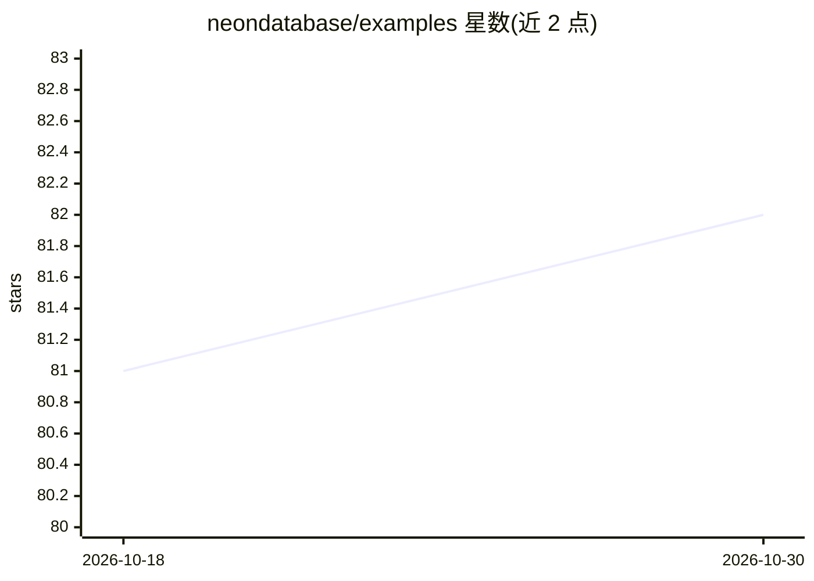

# neondatabase/examples

⭐ 82 · TypeScript · Apache-2.0 · 推送 2026-10-28 · [GitHub](https://github.com/neondatabase/examples) · [官网](https://fuzzy-semantic-search-nextjs-theta.vercel.app) · 组织维护

**Neon 云 Postgres 的集成示例与起步工程合集**

Neon 官方维护的示例仓库：每个子目录是独立可运行示例，克隆后配置 DATABASE_URL 即可运行。收录 Next.js + Drizzle 起步模板、基于 pgvector 的 RAG/语义检索/混合检索/聊天机器人启动器、部署于 Neon Functions 的 Discord/Telegram/WhatsApp 机器人示例，以及 neon functions new 脚手架所用模板。面向使用 Neon（基于 Lakebase Postgres 的云后端原语集，支持存储计算分离、空闲缩容至零与数据库分支）的开发者。

## 筛选速览

| 维度 | 判定 | 备注 |
|---|---|---|
| AI 角色 | `ai-knowledge` | 知识聚合/清单类 |
| 许可风险 | `permissive` | Apache-2.0 |
| 部署形态 | `None` |  |
| 模型依赖 | — | README 未给出锁定关系 |
| 硬件要求 | — | 无带数字的原话,不猜 |
| 安装摩擦 | `low` | 无编译、无系统依赖或容器化 |
| 成熟度 | — | 结构信号不足 |

## 能力要点

- 每个子目录为自包含示例，配置 DATABASE_URL 即可运行
- 含 pgvector 上的 RAG/语义检索/混合检索/聊天机器人启动器
- 涵盖 Next.js、Discord/Telegram/WhatsApp 机器人等场景
- 包含 neon functions new 脚手架模板源

## 适用场景

- 为我的应用找一个 Neon 集成起步模板
- 在 Neon 上快速搭建 pgvector RAG 或语义检索原型
- 参考官方示例学习 Neon Functions 与数据库分支用法

## 场景标签

`RAG` `语义搜索` `聊天机器人` · 领域:对话与助手

## 证据(README 行号)

> L3: # Neon examples
> L5: Example applications and starter projects for Neon. Each subdirectory is a self-contained example you can clone, con
> L10: - `ai/` - RAG, semantic search, hybrid search, and chatbot starters using pgvector on Neon.

## 星数曲线

2026-10-18 81 → 2026-10-30 82（+1）

---
*卡片 v1 · prompt 1.4 · 生成 2026-10-24 · 置信度 high · 依据 README sha `5b30d1109f7d` · [字段定义](../../DATASET.md)*
