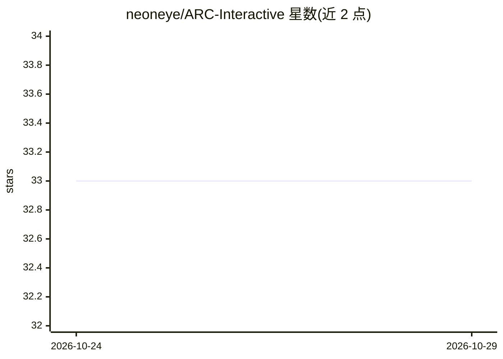

# neoneye/ARC-Interactive

⭐ 33 · JavaScript · MIT · 推送 2026-10-23 · [GitHub](https://github.com/neoneye/ARC-Interactive) · [官网](https://neoneye.github.io/arc/) · 个人维护

**在浏览器中解答 ARC 抽象推理谜题并沉淀交互数据集**

纯前端网页应用（HTML+CSS+JS），让用户在浏览器中探索和解答 Abstraction and Reasoning Corpus（ARC）谜题，内置任务画廊与任务编辑器。无自定义后端，已解谜题提交至 Supabase 存储，经审核页人工筛选后，批准的交互历史发布到 ARC-Interactive-History-Dataset 仓库，形成公开数据集。用户通过 Discord 讨论并参与贡献代码与反馈。

## 筛选速览

| 维度 | 判定 | 备注 |
|---|---|---|
| AI 角色 | `ai-knowledge` | 知识聚合/清单类 |
| 许可风险 | `permissive` | MIT |
| 部署形态 | `None` |  |
| 模型依赖 | — | README 未给出锁定关系 |
| 硬件要求 | — | 无带数字的原话,不猜 |
| 安装摩擦 | `low` | 无编译、无系统依赖或容器化 |
| 成熟度 | — | 结构信号不足 |

## 能力要点

- 浏览器内直接解答 ARC 谜题，含任务画廊与任务编辑器
- 无自定义后端，解答数据经 Supabase 存储与人工审核
- 批准的交互历史发布为公开数据集（ARC-Interactive-History-Dataset）

## 适用场景

- 在浏览器中体验和解答 ARC 抽象推理谜题
- 为 ARC 研究贡献人类解题交互历史数据
- 浏览 ARC 数据集中的任务样例并编辑任务

## 场景标签

`模型评测` · 领域:评测与运维

## 证据(README 行号)

> L5: Explore the puzzles of the Abstraction and Reasoning Corpus (ARC).
> L9: Solved puzzles are submitted to Supabase and curated on the review page. Setup notes are in supabase/README.md. Appr

## 星数曲线

2026-10-24 33 → 2026-10-29 33（+0）

---
*卡片 v1 · prompt 1.4 · 生成 2026-10-25 · 置信度 mid · 依据 README sha `0b99a2e0d7d5` · [字段定义](../../DATASET.md)*
