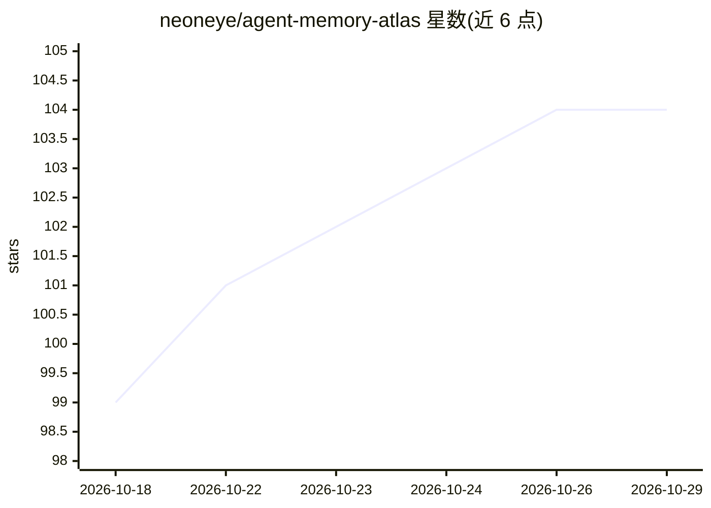

# neoneye/agent-memory-atlas

⭐ 104 · HTML · MIT · 推送 2026-10-28 · [GitHub](https://github.com/neoneye/agent-memory-atlas) · [官网](https://neoneye.github.io/agent-memory-atlas/) · 个人维护

**AI agent 记忆系统的代码级对比研究与策展图谱**

面向为 AI agent 选型记忆系统的开发者的代码级田野指南：对源码可公开读取的记忆系统（含十六个非开源项目）逐个生成报告，从记忆单元、存储模型、写入路径、检索机制、纠错语义、信任模型到运维风险进行横向比较，每份报告链接到所分析的确切 Git commit。仓库还提供可复用的架构模式指南、机器可读的验收测试协议、新系统筛查流程与静态站点构建。本地构建需要 Pandoc，通过 npm 构建。

## 筛选速览

| 维度 | 判定 | 备注 |
|---|---|---|
| AI 角色 | `ai-knowledge` | 知识聚合/清单类 |
| 许可风险 | `permissive` | MIT |
| 部署形态 | `None` |  |
| 模型依赖 | — | README 未给出锁定关系 |
| 硬件要求 | — | 无带数字的原话,不猜 |
| 安装摩擦 | `low` | 无编译、无系统依赖或容器化 |
| 成熟度 | — | 结构信号不足 |

## 能力要点

- 跨系统对比记忆单元、存储模型、检索机制、信任模型等维度
- 每份报告链接到被分析的确切 Git commit
- 提供可复用记忆架构模式指南与机器可读验收测试协议
- 收录前运行仓库安全筛查脚本（不执行被检树内任何代码）

## 适用场景

- 为自研 agent 产品调研并选择记忆系统
- 查阅各记忆系统的写入/检索/纠错机制对比
- 按模式指南设计自己的 agent 记忆架构

## 场景标签

`精选清单` · 领域:学习与行业

## 证据(README 行号)

> L3: A code-grounded field guide to memory systems for AI agents.
> L5: The atlas compares memory units, storage models, write paths, retrieval mechanics, correction semantics, trust model

## 星数曲线

2026-10-18 99 → 2026-10-29 104（+5）

---
*卡片 v1 · prompt 1.4 · 生成 2026-10-23 · 置信度 high · 依据 README sha `bb48c33c7ee6` · [字段定义](../../DATASET.md)*
