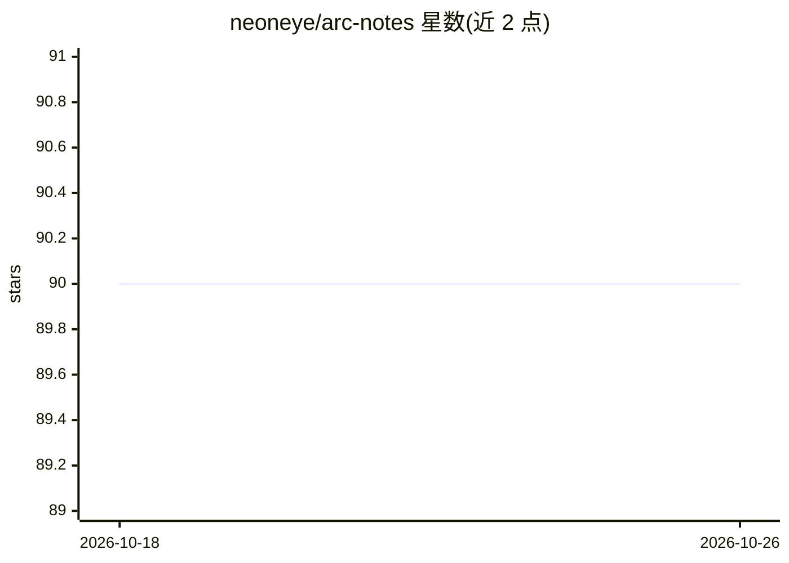

# neoneye/arc-notes

⭐ 90 · MIT · 推送 2025-12-09 · [GitHub](https://github.com/neoneye/arc-notes) · 个人维护

**关于 ARC（抽象与推理语料库）的个人笔记文集**

作者撰写的一系列关于 ARC（Abstraction and Reasoning Corpus）的笔记文章。内容为作者的思考记录与笔记，README 中提及作者的 ARC 相关实验代码位于 loda-rust 仓库中进行。仓库以文章/笔记形式组织，属于 awesome-list 类别的写作集合，面向关注 ARC 人工智能基准的研究者与读者。

## 筛选速览

| 维度 | 判定 | 备注 |
|---|---|---|
| AI 角色 | `ai-knowledge` | 知识聚合/清单类 |
| 许可风险 | `permissive` | MIT |
| 部署形态 | `None` |  |
| 模型依赖 | — | README 未给出锁定关系 |
| 硬件要求 | — | 无带数字的原话,不猜 |
| 安装摩擦 | `low` | 无编译、无系统依赖或容器化 |
| 成熟度 | — | 结构信号不足 |

## 能力要点

- 围绕 ARC（抽象与推理语料库）主题的笔记文章集合
- 作者的 ARC 实验代码位于 loda-rust 仓库

## 适用场景

- 了解作者对 ARC 基准的思考与笔记
- 查找 ARC 相关实验的代码仓库指向

## 场景标签

`精选清单` · 领域:学习与行业

## 证据(README 行号)

> L1: # My notes about ARC (Abstraction and Reasoning Corpus)

## 星数曲线

2026-10-18 90 → 2026-10-26 90（+0）

---
*卡片 v1 · prompt 1.4 · 生成 2026-10-23 · 置信度 mid · 依据 README sha `8cebd6fa0cf0` · [字段定义](../../DATASET.md)*
