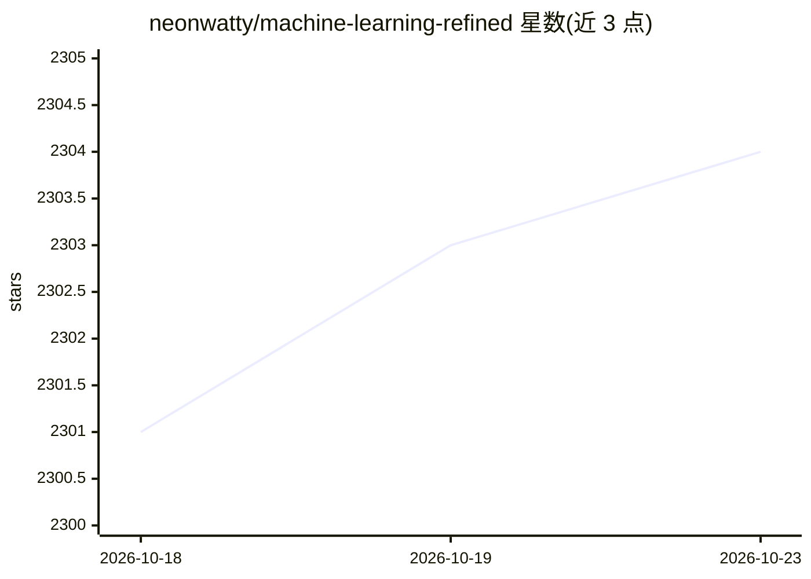

# neonwatty/machine-learning-refined

⭐ 2,304 · Python · NOASSERTION · 推送 2026-10-12 · [GitHub](https://github.com/neonwatty/machine-learning-refined) · [官网](https://www.mlrefined.com/) · 组织维护

**机器学习教材配套资源库：章节PDF、笔记、练习与讲义**

《Machine Learning Refined》第二版教材的官方配套仓库，提供各章节 PDF 下载、Jupyter/Colab 源笔记本、练习、PPTX 讲义及学习路线图。教学法强调直觉、数学推导与不依赖高层库的 Python 从零实现，覆盖优化方法、回归、分类、无监督学习、核方法、神经网络、树模型与自动微分等主题，面向自学读者与高校教师。技术前置仅需 Python 与线性代数基础。

## 筛选速览

| 维度 | 判定 | 备注 |
|---|---|---|
| AI 角色 | `ai-knowledge` | 知识聚合/清单类 |
| 许可风险 | `none` | NOASSERTION |
| 部署形态 | `self-host` | docker 或自建部署 |
| 模型依赖 | — | README 未给出锁定关系 |
| 硬件要求 | — | 无带数字的原话,不猜 |
| 安装摩擦 | `low` | 无编译、无系统依赖或容器化 |
| 成熟度 | — | 结构信号不足 |

## 能力要点

- 各章节 PDF、Jupyter 笔记本、练习与讲义可下载
- 从零实现 ML 模型的教学法（直觉→推导→实现）
- 提供四种课程/自学路线图（要点版、完整版、优化、深度学习）
- 提供 Colab 与本地 Jupyter 运行方式

## 适用场景

- 自学机器学习基础并从零实现经典模型
- 高校教师选用教材并获取讲义与练习
- 按路线图规划课程或自学路径

## 场景标签

`教程课程` · 领域:学习与行业

## 证据(README 行号)

> L7: This repository contains a range of resources associated with the 2nd edition of the university textbook Machine Lea
> L13: - Read or download the chapter PDFs

## 星数曲线

2026-10-18 2,301 → 2026-10-23 2,304（+3）

---
*卡片 v1 · prompt 1.4 · 生成 2026-10-21 · 置信度 mid · 依据 README sha `7ee3230af4b4` · [字段定义](../../DATASET.md)*
