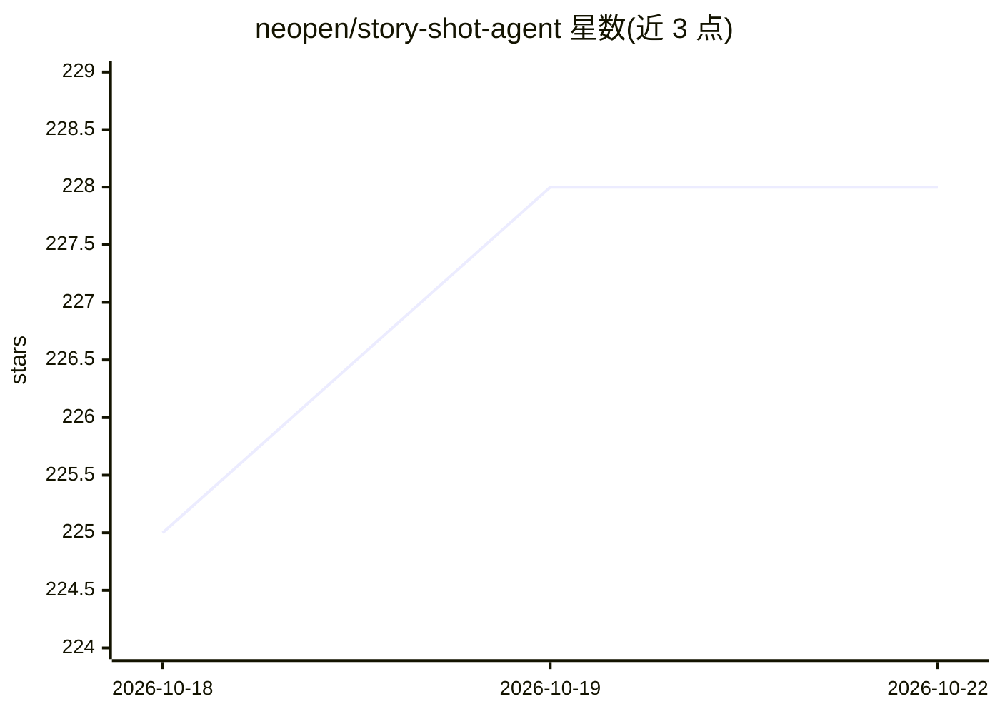

# neopen/story-shot-agent

⭐ 228 · Python · MIT · 推送 2026-10-17 · [GitHub](https://github.com/neopen/story-shot-agent) · [官网](https://shot.helpenx.com/) · 个人维护 · 中文 README

**剧本转分镜智能体：任意剧本拆分为视频模型提示词**

基于 LangChain+LangGraph 多智能体协作的剧本分镜系统，面向 AI 视频创作者与开发者：解析电影、短剧、动漫、小说等任意格式剧本，智能分段并生成 Sora/Veo/Runway/可灵可用的中英双语镜头级提示词与负面词、音频提示词。通过三级记忆、RAG 与 Chroma 向量检索维持角色/场景/剧情跨片段一致。提供 Python SDK、MCP、REST API、A2A 等集成方式，支持 OpenAI/Qwen/DeepSeek/Ollama 等 LLM。需外部 LLM API，当前针对中文剧本优化。

## 筛选速览

| 维度 | 判定 | 备注 |
|---|---|---|
| AI 角色 | `ai-native` | 本体是模型或模型工具 |
| 许可风险 | `permissive` | MIT |
| 部署形态 | `self-host` | docker 或自建部署 |
| 模型依赖 | local-ok | 支持本地模型 |
| 硬件要求 | — | 无带数字的原话,不猜 |
| 安装摩擦 | `low` | 无编译、无系统依赖或容器化 |
| 成熟度 | — | 结构信号不足 |

## 能力要点

- 任意格式剧本拆分为镜头级 text-to-video 提示词
- 三级记忆+RAG+Chroma 向量检索维持跨片段一致性
- 多模型可插拔：OpenAI/Qwen/DeepSeek/Ollama
- 提供 Python SDK、MCP、REST API、A2A、LangGraph 节点多种接入方式

## 适用场景

- 把小说或电影剧本自动转为 Sora/Veo 可用的分镜提示词
- 在 AI 视频生产流水线中作为分镜 Agent 节点接入（MCP/A2A/REST）
- 长剧本分段生成并保持角色与场景一致性

## 场景标签

 · 领域:AI 视频创作工具/LLM Agent

## 证据(README 行号)

> L12:  基于 LangChain + LangGraph 多智能体协作的剧本转分镜系统，确保叙事连续性与镜头级提示词生成。
> L33: > 🚀 **一键转换**：支持任意格式剧本（电影、短剧、动漫、小说等） → 镜头级描述 → **Sora / Veo / Runway / 可灵 Ready Prompt**
> L35: > 🔌 **多端生态支持**：开箱即用 **Python SDK、MCP 服务、Function Calling、REST API 及 LangGraph 节点**

## 星数曲线

2026-10-18 225 → 2026-10-22 228（+3）

---
*卡片 v1 · prompt 1.4 · 生成 2026-10-22 · 置信度 high · 依据 README sha `ff5113a39e62` · [字段定义](../../DATASET.md)*
