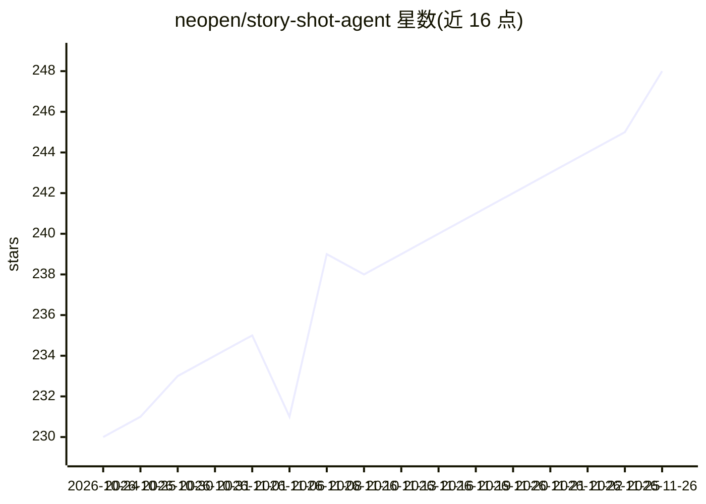

# neopen/story-shot-agent

⭐ 248 · Python · Apache-2.0 · 推送 2026-11-24 · [GitHub](https://github.com/neopen/story-shot-agent) · [官网](https://shot.helpenx.com/) · 个人维护 · 中文 README

**面向影视/小说创作者的剧本转分镜提示词生成智能体**

基于 LangChain + LangGraph 多智能体协作的剧本转分镜系统：解析任意格式剧本（电影、短剧、动漫、小说），按镜头粒度切分并规划时长，生成 Sora/Veo/Runway/可灵等文生视频模型可用的中英双语提示词、负面词与音频提示词。通过三视图、RAG 知识库、三级记忆、Chroma 向量检索与快照机制维持角色/场景/剧情跨片段一致。默认不调用生图/生视频 API，仅产出声明式指令，支持 REST/SDK/MCP/A2A 回填下游资产。中文剧本深度优化，需外部 LLM API。

## 筛选速览

| 维度 | 判定 | 备注 |
|---|---|---|
| AI 角色 | `ai-native` | 本体是模型或模型工具 |
| 许可风险 | `permissive` | Apache-2.0 |
| 部署形态 | `self-host` | docker 或自建部署 |
| 模型依赖 | local-ok | 支持本地模型 |
| 硬件要求 | — | 无带数字的原话,不猜 |
| 安装摩擦 | `low` | 无编译、无系统依赖或容器化 |
| 成熟度 | — | 结构信号不足 |

## 能力要点

- 剧本→镜头级切分→text-to-video 提示词的端到端转换
- 三级记忆 + Chroma 向量检索 + RAG 保障角色/剧情跨片段一致
- 提供 Python SDK、REST API、MCP、A2A、LangGraph 节点五种集成方式
- 每个分镜片段可双向追溯至原剧本位置

## 适用场景

- 把长剧本转成 Sora/Veo 可直接使用的分镜提示词
- 短剧/动漫制作中保持角色形象跨镜头一致
- 作为中间节点接入 A2A 多智能体创作流水线
- 通过 MCP 在支持 MCP 的 IDE/Agent 框架中调用分镜能力

## 场景标签

`提示工程` · 领域:Agent 开发

## 证据(README 行号)

> L11:  基于 LangChain + LangGraph 多智能体协作的剧本转分镜系统，确保叙事连续性与镜头级提示词生成。
> L32: - 🚀 **一键转换**：支持任意格式剧本（电影、短剧、动漫、小说等） → 镜头级描述 → **Sora / Veo / Runway / 可灵 等Prompt**
> L55: |多协议集成|提供 Python SDK、REST API、LangGraph 节点、A2A 协作协议与 MCP 标准接口|

## 星数曲线

2026-10-24 230 → 2026-11-26 248（+18）

---
*卡片 v1 · prompt 1.4 · 生成 2026-11-25 · 置信度 high · 依据 README sha `ff348edb3aa6` · [字段定义](../../DATASET.md)*
