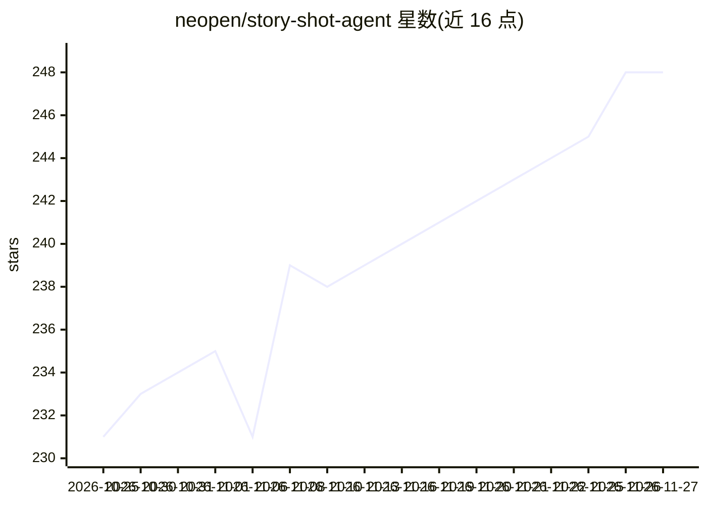

# neopen/story-shot-agent

⭐ 248 · Python · Apache-2.0 · 推送 2026-11-26 · [GitHub](https://github.com/neopen/story-shot-agent) · [官网](https://shot.helpenx.com/) · 个人维护 · 中文 README

**剧本转分镜的 LLM 智能体：生成文生视频提示词**

基于 LangGraph+LlamaIndex 多智能体协作的系统：解析任意格式剧本（电影/短剧/动漫/小说），按镜头切分并分配时长，通过 RAG 知识库、三级记忆与 Chroma 向量检索维持角色/场景/剧情跨片段一致，输出中英双语画面描述、负面词与音频提示词。默认不调用生视频 API，只产出声明式指令供下游模型消费。提供 Python SDK、REST API、MCP Server、A2A 协议与 LangGraph 节点五种接入方式；中文剧本深度优化，其他语言仍在迭代。

## 筛选速览

| 维度 | 判定 | 备注 |
|---|---|---|
| AI 角色 | `ai-native` | 本体是模型或模型工具 |
| 许可风险 | `permissive` | Apache-2.0 |
| 部署形态 | `self-host` | docker 或自建部署 |
| 模型依赖 | local-ok | 支持本地模型 |
| 硬件要求 | — | 无带数字的原话,不猜 |
| 安装摩擦 | `low` | 无编译、无系统依赖或容器化 |
| 成熟度 | — | 结构信号不足 |

## 能力要点

- 支持任意格式剧本解析与镜头级切分、时长规划
- 三视图+RAG+三级记忆+Chroma 检索保障跨片段一致性
- 五种集成方式：Python SDK、REST API、MCP、A2A、LangGraph 节点
- 输出 Sora/Veo/Runway/可灵 可用的 text-to-video 提示词

## 适用场景

- 把长剧本批量转成分镜片段的视频提示词
- 在 LangGraph 流水线中作为自动化分镜节点
- 上游剧本 Agent 与下游文生视频 Agent 之间的中间编排环节

## 场景标签

`文档解析` · 领域:知识与检索

## 证据(README 行号)

> L11:  基于 LangChain + LangGraph 多智能体协作的剧本转分镜系统，确保叙事连续性与镜头级提示词生成。
> L33: - 🧠 **连续性保障**：三视图 + RAG 知识库 + 三级记忆 + Chroma 向量检索 + 快照机制 + 多维召回，确保角色/场景/剧情跨片段一致
> L143: PenShot 只产出声明式指令，**默认不调用任何生图/生视频 API**。下游可直接消费结果中的资产提示词：

## 星数曲线

2026-10-25 231 → 2026-11-27 248（+17）

---
*卡片 v1 · prompt 1.4 · 生成 2026-11-26 · 置信度 high · 依据 README sha `85777708bc45` · [字段定义](../../DATASET.md)*
