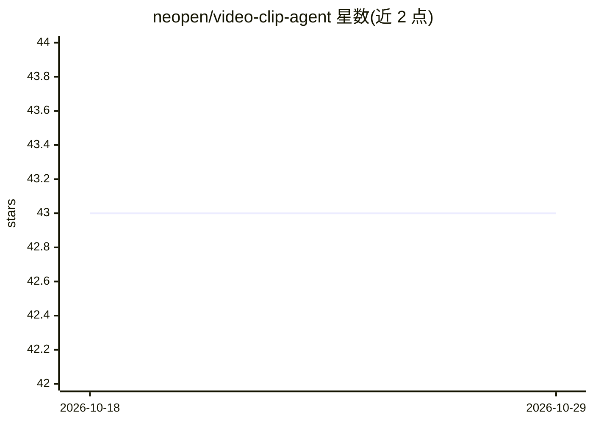

# neopen/video-clip-agent

⭐ 43 · Python · MIT · 推送 2026-10-23 · [GitHub](https://github.com/neopen/video-clip-agent) · [官网](https://clip.helpenx.com/) · 个人维护 · 中文 README

**自然语言驱动的视频混剪智能体：分析、筛选、裁剪、合成多个视频**

基于星型中枢分发架构（CentralHub：命令解析→意图识别→风险评估→能力路由）的 AI 视频混剪系统，含 Planner/Analyzer/Matcher/Composer 多智能体，利用 CLIP 语义标注、语音识别、情绪分析、场景检测与 FFmpeg 完成素材分析与合成。支持 OpenAI/Qwen/DeepSeek/Ollama 四种 LLM 提供商，以交互式控制台（REPL）为主要使用方式，REST 异步 API 为备用。当前 V0.1：LangGraph 编排、services/、infrastructure/ 多为 V0.2 占位 stub；需 Python 3.9+ 与 FFmpeg。

## 筛选速览

| 维度 | 判定 | 备注 |
|---|---|---|
| AI 角色 | `ai-native` | 本体是模型或模型工具 |
| 许可风险 | `permissive` | MIT |
| 部署形态 | `library` | 以包/库形式分发 |
| 模型依赖 | local-ok | 支持本地模型 |
| 硬件要求 | — | 无带数字的原话,不猜 |
| 安装摩擦 | `medium` | 含编译或系统依赖之一 |
| 成熟度 | `idea` | |

## 能力要点

- 星型中枢分发：意图识别（30+ 意图枚举）+ 风险评估 + 能力路由
- CLIP 语义标注、语音识别、情绪分析、场景检测、FFmpeg 合成
- 交互式 REPL：澄清式对话、渐进式细化、高风险操作确认中断
- 多 LLM 提供商支持：OpenAI / 通义千问 / DeepSeek / Ollama（本地）

## 适用场景

- 用自然语言描述需求，自动完成多视频素材的筛选与混剪
- 旅行 Vlog 等内容的时间线规划与自动合成
- 对视频素材做语义标注与情绪/场景分析

## 场景标签

`图像视频处理` `多智能体` · 领域:Agent 开发

## 证据(README 行号)

> L3: 基于**星型中枢分发架构**的 AI 视频混剪系统。以自然语言驱动视频分析、片段匹配与自动合成，通过多智能体协作实现「人机协同」的创作体验—— AI 辅助而非替代创作者。
> L31: - **多 AI 提供商**：OpenAI / 通义千问 Qwen / DeepSeek / Ollama（本地模型）
> L32: - **视频处理**：场景检测、语义标注（CLIP）、语音识别、情绪分析、物体检测、FFmpeg 合成

## 星数曲线

2026-10-18 43 → 2026-10-29 43（+0）

---
*卡片 v1 · prompt 1.4 · 生成 2026-10-25 · 置信度 mid · 依据 README sha `6a1391f4a46b` · [字段定义](../../DATASET.md)*
