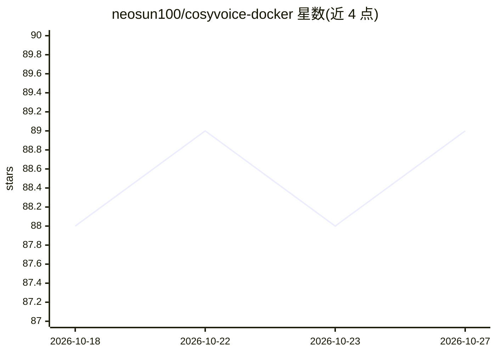

# neosun100/cosyvoice-docker

⭐ 89 · Python · Apache-2.0 · 推送 2026-01-18 · [GitHub](https://github.com/neosun100/cosyvoice-docker) · 个人维护 · 中文 README

**CosyVoice 语音合成的 All-in-One Docker 服务：Web UI + API + 声音克隆**

基于 Fun-CosyVoice3-0.5B 模型的文本转语音（TTS）服务，以单个 Docker 镜像打包提供 Web UI、REST API 与自定义声音克隆功能。内置 Fun-ASR-Nano 做语音识别，API 兼容 OpenAI /v1/audio/speech 端点。支持中英日韩及多语言、18 种中文方言，实时流式输出（TTFB 约 1.2s），并提供声音 embedding 缓存。运行需 NVIDIA GPU（8GB+ VRAM）与 NVIDIA Container Toolkit，FastAPI + Gradio + PyTorch/CUDA 技术栈，Apache 2.0 许可。

## 筛选速览

| 维度 | 判定 | 备注 |
|---|---|---|
| AI 角色 | `ai-native` | 本体是模型或模型工具 |
| 许可风险 | `permissive` | Apache-2.0 |
| 部署形态 | `self-host` | docker 或自建部署 |
| 模型依赖 | — | README 未给出锁定关系 |
| 硬件要求 | — | 无带数字的原话,不猜 |
| 安装摩擦 | `low` | 无编译、无系统依赖或容器化 |
| 成熟度 | — | 结构信号不足 |

## 能力要点

- OpenAI 兼容 /v1/audio/speech 端点
- 自定义声音上传一次后按 voice_id 复用
- PCM 流式输出，TTFB 约 1.2s，embedding 缓存后提速 53%
- 内置 Fun-ASR-Nano 语音识别，支持中英日韩及 18 种中文方言

## 适用场景

- 一条 Docker 命令部署带 Web UI 的 TTS 服务
- 通过 OpenAI 兼容 API 接入现有应用的语音合成
- 上传音频样本克隆自定义音色并按 voice_id 调用

## 场景标签

`语音合成` · 领域:内容生成

## 证据(README 行号)

> L10: **Production-ready Text-to-Speech service based on Fun-CosyVoice3-0.5B**
> L26: |🔌 **OpenAI Compatible API**|Drop-in replacement for `/v1/audio/speech`|
> L105: |`/v1/audio/speech`|POST|Text-to-Speech (OpenAI compatible)|

## 星数曲线

2026-10-18 88 → 2026-10-27 89（+1）

---
*卡片 v1 · prompt 1.4 · 生成 2026-10-23 · 置信度 high · 依据 README sha `631d6e59393a` · [字段定义](../../DATASET.md)*
