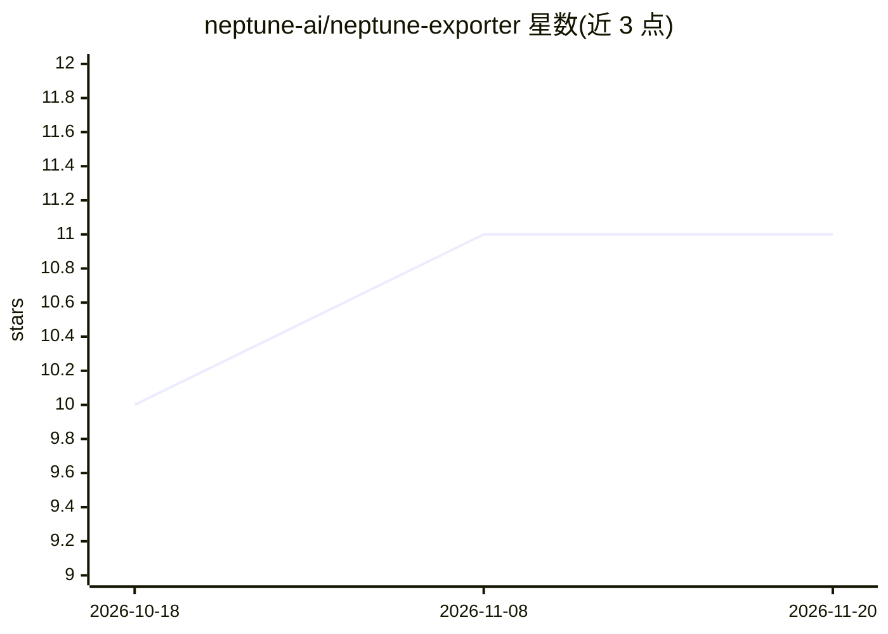

# neptune-ai/neptune-exporter

⭐ 11 · Python · NOASSERTION · 推送 2026-03-03 · [GitHub](https://github.com/neptune-ai/neptune-exporter) · [官网](https://docs.neptune.ai/transition_hub) · 组织维护

**把 Neptune 实验数据导出为 parquet 的迁移 CLI 工具**

面向需要从 Neptune 实验追踪平台迁出的团队：将 Neptune 2.x/3.x 的实验运行数据以流式方式导出到本地磁盘，生成 parquet 数据文件与伴随的工件文件，支持导出 2.x 模型注册表对象；已导出的运行会被跳过以支持断点续传。随后可将数据载入 Comet、MLflow、W&B、ZenML、GoodSeed、Lightning AI、Minfx、Pluto 等替代追踪工具，尽量保留运行结构（forks、steps、attributes）。需要 Python 3.13 与 uv 管理，未发布到 PyPI，需克隆仓库直接运行。

## 筛选速览

| 维度 | 判定 | 备注 |
|---|---|---|
| AI 角色 | `ai-ecosystem` | LLM/agent 周边工具 |
| 许可风险 | `none` | NOASSERTION |
| 部署形态 | `library` | 以包/库形式分发 |
| 模型依赖 | — | README 未给出锁定关系 |
| 硬件要求 | — | 无带数字的原话,不猜 |
| 安装摩擦 | `low` | 无编译、无系统依赖或容器化 |
| 成熟度 | — | 结构信号不足 |

## 能力要点

- 将 Neptune 2.x/3.x 运行数据导出为 parquet + 文件，支持断点续传
- 支持导出 Neptune 2.x 模型注册表对象
- 可载入 8 种替代追踪工具并尽量保留运行结构
- 提供项目发现模式与正则过滤、NQL 查询过滤

## 适用场景

- 把 Neptune 上的实验数据批量导出到本地归档
- 从 Neptune 迁移到 MLflow、W&B 等其他追踪工具
- 按正则或日期范围筛选需要导出的运行与项目

## 场景标签

 · 领域:MLOps/实验追踪迁移

## 证据(README 行号)

> L3: Neptune Exporter is a CLI tool to move Neptune experiments (version `2.x` or `3.x`) to disk as parquet and files, wi
> L19: - Loads parquet data into alternative tools while preserving run structure (forks, steps, attributes) as closely as

## 星数曲线

2026-10-18 10 → 2026-11-20 11（+1）

---
*卡片 v1 · prompt 1.4 · 生成 2026-11-18 · 置信度 mid · 依据 README sha `c3cf4dfdad93` · [字段定义](../../DATASET.md)*
