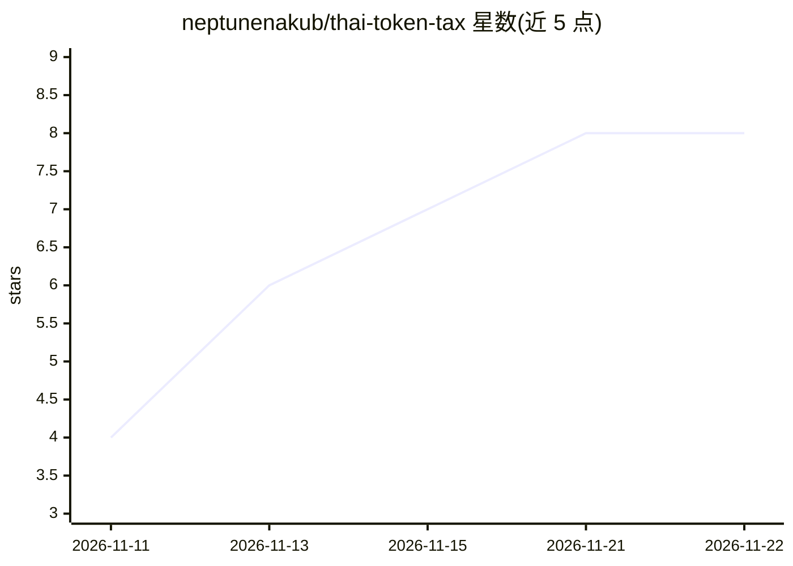

# neptunenakub/thai-token-tax

⭐ 8 · Python · MIT · 推送 2026-11-11 · [GitHub](https://github.com/neptunenakub/thai-token-tax) · [官网](https://neptunenakub.github.io/thai-token-tax/) · 个人维护

**面向泰语用户的 LLM token 成本对比基准与计算器**

测量 45 个模型（13 个不同分词器）在 1,012 句 FLORES-200 泰英平行句上的每千字符 token 数，乘以官方列表价与泰国央行汇率，换算为月度泰铢成本，并按聊天机器人、文档摘要、内容写作三个示例工作负载给出账单对比。提供 ttt 命令行工具本地复现，无需 API key；API 模型经官方计数端点测得，缺 key 时报告为 blocked 而非估算。仅测 token 成本，不含回答质量、缓存折扣等。

## 筛选速览

| 维度 | 判定 | 备注 |
|---|---|---|
| AI 角色 | `ai-knowledge` | 知识聚合/清单类 |
| 许可风险 | `permissive` | MIT |
| 部署形态 | `library` | 以包/库形式分发 |
| 模型依赖 | — | README 未给出锁定关系 |
| 硬件要求 | — | 无带数字的原话,不猜 |
| 安装摩擦 | `low` | 无编译、无系统依赖或容器化 |
| 成熟度 | — | 结构信号不足 |

## 能力要点

- 45 个模型、13 个分词器在 FLORES-200 泰语句上的 token 密度测量
- 官方列表价 × 汇率换算为泰铢月成本，附网页计算器
- ttt CLI 本地复现，结果文件按日期写入不可覆盖，文档由测试保证与数据一致
- registry TOML 注册表方式新增模型或语言，无需改代码

## 适用场景

- 为泰语应用选型 LLM 时估算每月 API 账单
- 比较不同分词器对泰语文本的 token 开销
- 复现或扩展基准到其他语言

## 场景标签

`模型评测` · 领域:评测与运维

## 证据(README 行号)

> L16: 45 models (13 distinct tokenizers) on 1,012 parallel Thai–English sentences
> L48: Every model's own tokenizer counts the same content in Thai and in English. Two numbers come out, and
> L193: src/thai_token_tax/    the `ttt` command: prepare, count, verify, analyze, prices, cost, compare, site, docs

## 星数曲线

2026-11-11 4 → 2026-11-22 8（+4）

---
*卡片 v1 · prompt 1.4 · 生成 2026-11-21 · 置信度 high · 依据 README sha `0eb648cba6de` · [字段定义](../../DATASET.md)*
