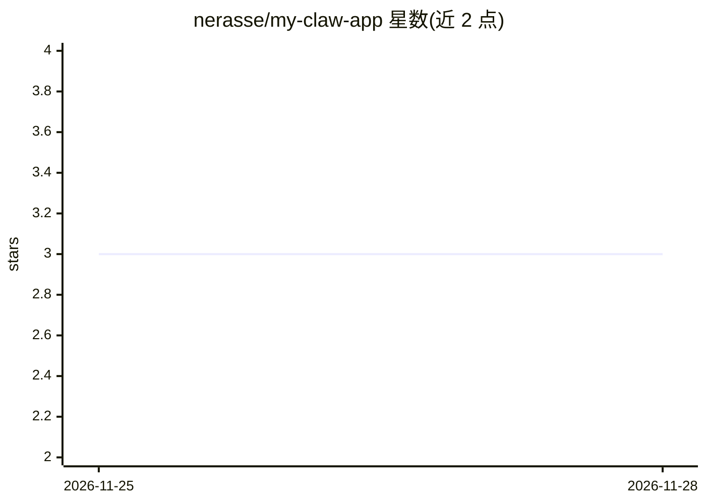

# nerasse/my-claw-app

⭐ 3 · TypeScript · MIT · 推送 2026-11-26 · [GitHub](https://github.com/nerasse/my-claw-app) · 个人维护

**my-claw agent 服务器的 Android/网页客户端**

my-claw 服务器的客户端：agent、工具、会话与记忆保留在用户自有机器上，本仓库提供手机与浏览器界面。客户端通过一条出站 WebSocket 连接服务器，无需开放公网端口、无托管账号。功能包括流式回答、子 agent 卡片、黑名单工具的电话端审批、agent 浏览器实时面板（VNC 可选）、应用内语音留言与转录、会话/工作区抽屉、自托管 ntfy 推送。同一代码以 Android APK 发布并被服务器作为网页客户端提供，支持扫码配对与从服务器撤销设备。

## 筛选速览

| 维度 | 判定 | 备注 |
|---|---|---|
| AI 角色 | `ai-ecosystem` | LLM/agent 周边工具 |
| 许可风险 | `permissive` | MIT |
| 部署形态 | `library` | 以包/库形式分发 |
| 模型依赖 | — | README 未给出锁定关系 |
| 硬件要求 | — | 无带数字的原话,不猜 |
| 安装摩擦 | `low` | 无编译、无系统依赖或容器化 |
| 成熟度 | — | 结构信号不足 |

## 能力要点

- 单条出站 WebSocket 连接，无公网端口与托管中间账号
- 黑名单工具需在手机端审批后执行并记录日志
- agent 浏览器实时面板与可选 VNC 查看
- 自托管 ntfy（UnifiedPush）推送，不使用 Firebase

## 适用场景

- 在手机上远程查看和操作自己机器上的 agent 会话
- 高危工具调用前在手机上逐次批准
- 语音留言转写并与 agent 对话

## 场景标签

`AI 助手` · 领域:对话与助手

## 证据(README 行号)

> L14: The client of a my-claw server. The agent, its tools, its sessions and its memory stay on the
> L19: The connection goes out from the client to the server over a secure WebSocket. Nothing listens on a

## 星数曲线

2026-11-25 3 → 2026-11-28 3（+0）

---
*卡片 v1 · prompt 1.4 · 生成 2026-11-25 · 置信度 high · 依据 README sha `bc80bc3ffee7` · [字段定义](../../DATASET.md)*
