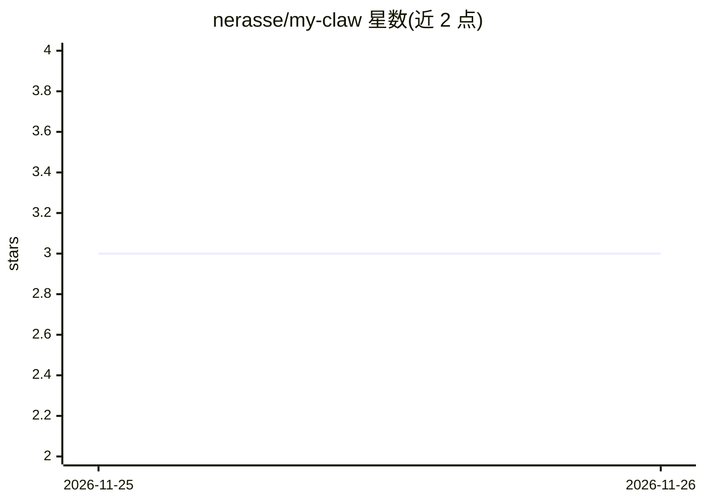

# nerasse/my-claw

⭐ 3 · TypeScript · MIT · 推送 2026-11-25 · [GitHub](https://github.com/nerasse/my-claw) · [官网](https://nerasse.github.io/my-claw/) · 个人维护

**自托管的单用户 AI agent 编排器，跑在自己的机器上**

在用户自有机器上运行的单用户 agent：通过 Web 客户端或 Android 应用访问，可操作 shell、文件、Chromium 浏览器、cron 任务并派生子 agent；对话以磁盘日志保存，重启不丢会话。模型端点全部由用户在 config.json 中声明（OpenAI 兼容端点、订阅、本地服务等），无托管版本，提示词发往用户声明的提供商。支持多工作区、远程节点配对、模型路由标签与配额重试。安装仅支持 Linux x86_64（Debian/Ubuntu），安装器需 sudo 并写入 systemd 单元。

## 筛选速览

| 维度 | 判定 | 备注 |
|---|---|---|
| AI 角色 | `ai-ecosystem` | LLM/agent 周边工具 |
| 许可风险 | `permissive` | MIT |
| 部署形态 | `None` |  |
| 模型依赖 | — | README 未给出锁定关系 |
| 硬件要求 | — | 无带数字的原话,不猜 |
| 安装摩擦 | `medium` | 含编译或系统依赖之一 |
| 成熟度 | — | 结构信号不足 |

## 能力要点

- 自带 shell、文件、搜索、fetch、Chromium 浏览器、cron 任务与子 agent 工具集，工具可用黑名单控制审批
- 工作区机制：同一 agent 管理多个代码库，各自目录、提示层与技能
- 模型路由标签：一个标签绑定模型、回退、effort 与上下文上限，配额错误自动沿路由重试
- Web 客户端与 Android 应用共享设备列表、会话与队列，支持远程节点配对

## 适用场景

- 在自己的服务器上托管一个可操作 shell 与浏览器的个人 agent
- 用一个 agent 同时管理多个代码库工作区
- 把另一台机器配对为节点，扩展 agent 可用的文件与 shell 工具
- 在多模型间配置带回退的路由，应对配额限制

## 场景标签

`AI 助手` · 领域:对话与助手

## 证据(README 行号)

> L3: Self-hosted AI agent orchestrator: one agent, real tools, your own machine.
> L20: The model is configuration: an OpenAI-compatible endpoint, a ChatGPT or Claude subscription,
> L21: Gemini, OpenRouter, or a local server. There is no hosted tier. Prompts go to the provider you

## 星数曲线

2026-11-25 3 → 2026-11-26 3（+0）

---
*卡片 v1 · prompt 1.4 · 生成 2026-11-24 · 置信度 mid · 依据 README sha `443d46a3eab0` · [字段定义](../../DATASET.md)*
