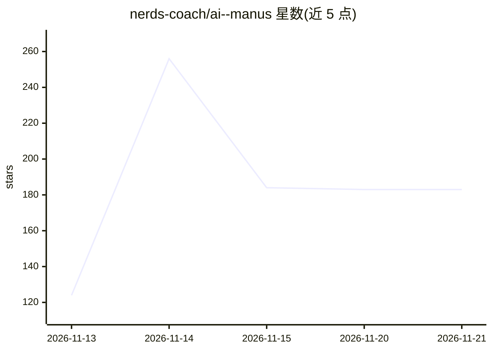

# nerds-coach/ai--manus

⭐ 183 · Apache-2.0 · 推送 2026-11-15 · [GitHub](https://github.com/nerds-coach/ai--manus) · 个人维护

**自主 AI Agent：代用户执行代码与控制浏览器完成任务**

README 以宣传口吻描述 Manus：一个自主 AI agent，代用户编写并执行脚本、控制浏览器（导航、填表、采集信息）、执行多步骤任务，定位为面向家庭、学习与轻量办公的个人助手，非企业平台。给出系统兼容性表（最低双核 CPU、4GB 内存）。但 README 未提供任何安装命令、代码仓库内容说明、模型接入方式或技术实现细节，仅含下载促销码与搜索关键词列表，可验证信息有限。

## 筛选速览

| 维度 | 判定 | 备注 |
|---|---|---|
| AI 角色 | `ai-native` | 本体是模型或模型工具 |
| 许可风险 | `permissive` | Apache-2.0 |
| 部署形态 | `None` |  |
| 模型依赖 | — | README 未给出锁定关系 |
| 硬件要求 | — | 无带数字的原话,不猜 |
| 安装摩擦 | `low` | 无编译、无系统依赖或容器化 |
| 成熟度 | — | 结构信号不足 |

## 能力要点

- 自主执行代码与浏览器控制（导航/填表/信息采集）
- 跨脚本与浏览器的多步骤任务流
- 面向家庭、学习与轻量任务场景，声明无需开发者背景
- 给出最低/推荐硬件兼容性表（双核 CPU、4GB RAM）

## 适用场景

- 让学生收集资料、运行小脚本并整理笔记
- 代替人工完成重复的网页检查与表单填写
- 轻量办公中跨多个页面汇总信息

## 场景标签

`AI 助手` `浏览器自动化` `编码 Agent` · 领域:效率与自动化

## 证据(README 行号)

> L10: - **Autonomous Code Execution:** Manus AI agent runs code on its own to complete tasks, so you can focus on decisio
> L18: Manus is an autonomous AI agent designed to run code and control a browser on your behalf. Instead of acting like a

## 星数曲线

2026-11-13 124 → 2026-11-21 183（+59）

---
*卡片 v1 · prompt 1.4 · 生成 2026-11-17 · 置信度 low · 依据 README sha `0f78ee3a5dd2` · [字段定义](../../DATASET.md)*
