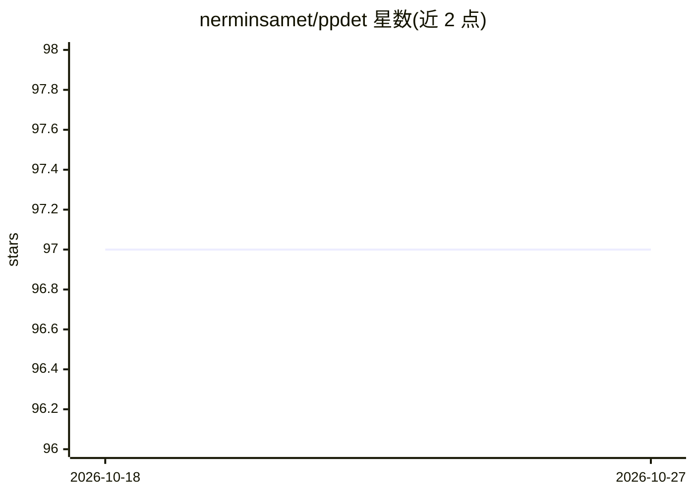

# nerminsamet/ppdet

⭐ 97 · Python · Apache-2.0 · 推送 2026-08-21 · [GitHub](https://github.com/nerminsamet/ppdet) · 组织维护

**BMVC 2020 论文 PPDet 官方实现：降低 anchor-free 检测器标签噪声**

论文 Reducing Label Noise in Anchor-Free Object Detection（BMVC 2020）的官方 PyTorch 实现，基于 open-mmlab 的 mmdetection 构建。PPDet 提出松弛标注策略，对 anchor-free 检测器内落于背景或遮挡物上的特征不再一律标正；训练时将各特征的预测 sum-pool 为单一预测，推理时采用相似的预测池化方法。提供 COCO val2017 上多个 backbone 的预训练模型（HF 下载），最佳模型 COCO test-dev 46.3 AP。安装遵循 mmdetection 的 INSTALL.md，支持单/多 GPU 训练与推理。

## 筛选速览

| 维度 | 判定 | 备注 |
|---|---|---|
| AI 角色 | `ai-native` | 本体是模型或模型工具 |
| 许可风险 | `permissive` | Apache-2.0 |
| 部署形态 | `None` |  |
| 模型依赖 | — | README 未给出锁定关系 |
| 硬件要求 | — | 无带数字的原话,不猜 |
| 安装摩擦 | `low` | 无编译、无系统依赖或容器化 |
| 成熟度 | — | 结构信号不足 |

## 能力要点

- 面向 anchor-free 检测器的松弛标注策略以降低标签噪声
- 训练与推理阶段采用预测 sum-pooling
- 提供 ResNet-50/101、ResNeXt-101 预训练模型（COCO test-dev 46.3 AP）
- 基于 mmdetection 实现，含 configs/ppdet 配置与单/多 GPU 训练推理脚本

## 适用场景

- 复现或改进 anchor-free 目标检测的标签分配研究
- 下载预训练模型在 COCO 数据上做目标检测
- 小目标检测相关实验对比（AP_s 31.4）

## 场景标签

`目标检测` · 领域:感知与多模态

## 证据(README 行号)

> L3: Official PyTroch implementation of PPDet based on open-mmlab's mmdetection.
> L10: Current anchor-free detectors label all features within a ground-truth box as positive. However features within a g

## 星数曲线

2026-10-18 97 → 2026-10-27 97（+0）

---
*卡片 v1 · prompt 1.4 · 生成 2026-10-23 · 置信度 high · 依据 README sha `b5e69cd4a518` · [字段定义](../../DATASET.md)*
