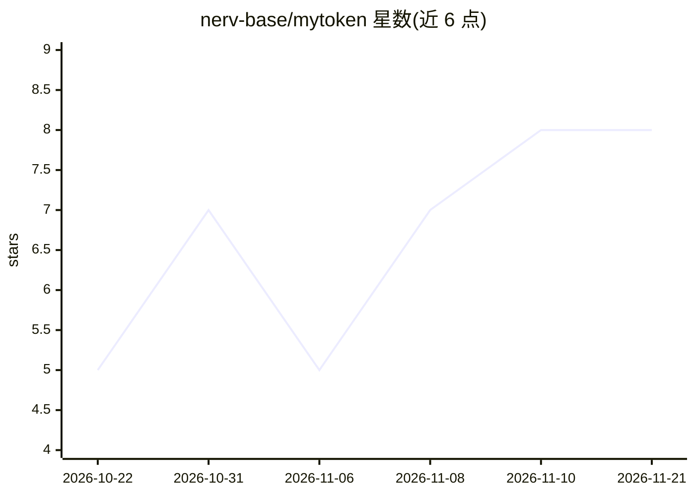

# nerv-base/mytoken

⭐ 8 · Go · MIT · 推送 2026-11-16 · [GitHub](https://github.com/nerv-base/mytoken) · 组织维护

**本地 AI 编码工具的 token 用量与成本追踪器**

读取本机上 AI 编码工具已写入磁盘的会话日志，按官方 API 牌价对每次请求计价，在原生桌面应用、菜单栏面板或命令行中展示今日/本月开销、订阅额度余量和正在运行的会话。覆盖 33 个工具（Claude Code、Codex CLI、Gemini CLI、Cline、Trae 等），区分五类 token 并支持按项目/天/工具拆分；全部数据留在本机，只读日志不回写。对加密的 Trae 数据库可自行解密读取。提供 dmg、exe、Linux 安装脚本、deb 包和 go install 多种安装方式。

## 筛选速览

| 维度 | 判定 | 备注 |
|---|---|---|
| AI 角色 | `ai-ecosystem` | LLM/agent 周边工具 |
| 许可风险 | `permissive` | MIT |
| 部署形态 | `desktop` | 安装包/桌面程序 |
| 模型依赖 | — | README 未给出锁定关系 |
| 硬件要求 | — | 无带数字的原话,不猜 |
| 安装摩擦 | `low` | 无编译、无系统依赖或容器化 |
| 成熟度 | — | 结构信号不足 |

## 能力要点

- 读取 33 个 AI 编码工具的本地日志并统一计价统计
- 五类 token（输入/输出/缓存读/缓存写/推理）分别核算，含缓存命中率与子 Agent 树
- 从各服务商自动拉取 Codex、Claude、GLM、DeepSeek 余额等订阅额度
- 菜单栏、桌面应用与 `mytoken` CLI 三种形态，数据不出本机

## 适用场景

- 查看今天和本月用各类 AI 编码工具花了多少 token 和钱
- 监控 Codex/Claude 等订阅额度的剩余量与重置时间
- 脚本中用 mytoken 命令获取当日/当月成本数据
- 按项目、模型、工具维度做长期用量排行分析

## 场景标签

`LLM 可观测性` · 领域:评测与运维

## 证据(README 行号)

> L19: **What did your AI coding cost today, and how much plan quota is left?** MyToken!!!!! reads the
> L21: list price, and shows today's and this month's spend, your plan quotas and what is running right
> L44: - **CLI for scripts** — `mytoken` prints today's and this month's cost; `mytoken daily` prints a

## 星数曲线

2026-10-22 5 → 2026-11-21 8（+3）

---
*卡片 v1 · prompt 1.4 · 生成 2026-11-20 · 置信度 high · 依据 README sha `9b7b60276fc2` · [字段定义](../../DATASET.md)*
