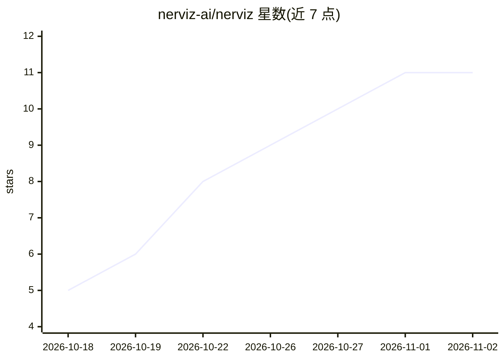

# nerviz-ai/nerviz

⭐ 11 · Java · Apache-2.0 · 推送 2026-10-31 · [GitHub](https://github.com/nerviz-ai/nerviz) · 组织维护

**面向 Spring Boot 的 Claude Code agent 治理套件：规范驱动生成并约束 AI 代码**

由规则、技能、钩子与蓝图构成的 agent harness，运行于 Claude Code 之上：以九种架构（六边形、整洁、分层、洋葱等，YAML 数据形式）通过 Spring Initializr 生成 Spring Boot 项目，并以钩子在写入时强制执行依赖方向、禁止导入与冻结规范，每次运行留有 token 与文件审计报告。提供 /init-project、/new-feature、/arch-adopt、/platform-upgrade 等命令，也可安装进既有项目。明确声明自身不是编码助手、不是 LangGraph/Spring AI 一类 agent 框架、不是项目模板；要求 JDK 21+、git、curl，不自带模型与编辑器。

## 筛选速览

| 维度 | 判定 | 备注 |
|---|---|---|
| AI 角色 | `ai-ecosystem` | LLM/agent 周边工具 |
| 许可风险 | `permissive` | Apache-2.0 |
| 部署形态 | `None` |  |
| 模型依赖 | locked-api |  |
| 硬件要求 | — | 无带数字的原话,不猜 |
| 安装摩擦 | `medium` | 含编译或系统依赖之一 |
| 成熟度 | — | 结构信号不足 |

## 能力要点

- 九种架构蓝图以 YAML 数据定义，新增架构不改提示词
- 钩子在写入时拒绝越界写入、禁止导入与对已批准规范的修改
- 版本来自 Spring Initializr 运行时，禁止模型凭记忆写版本号
- 每次技能/agent 调用留有 token、文件与失败记录的审计报告
- 生成的项目自带整个 harness 与 CI，可经 /arch-adopt 更新

## 适用场景

- 用 Claude Code 生成并长期维护符合 DDD 与依赖方向约束的 Spring Boot 项目
- 在既有 Spring Boot 项目上安装架构规则与写入钩子
- 通过 /platform-upgrade 升级 Spring Boot 版本并用 OpenRewrite 处理重命名

## 场景标签

`编码 Agent` `代码生成` · 领域:编码与开发

## 证据(README 行号)

> L77: The working definition in 2026 is *agent = model + harness*. Claude Code supplies the
> L87: It is **not** a coding assistant: it brings no model and no editor. It is **not** an agent
> L88: framework like LangGraph or Spring AI: those build agents, and this repository constrains

## 星数曲线

2026-10-18 5 → 2026-11-02 11（+6）

---
*卡片 v1 · prompt 1.4 · 生成 2026-11-01 · 置信度 high · 依据 README sha `bb05e39d45c3` · [字段定义](../../DATASET.md)*
