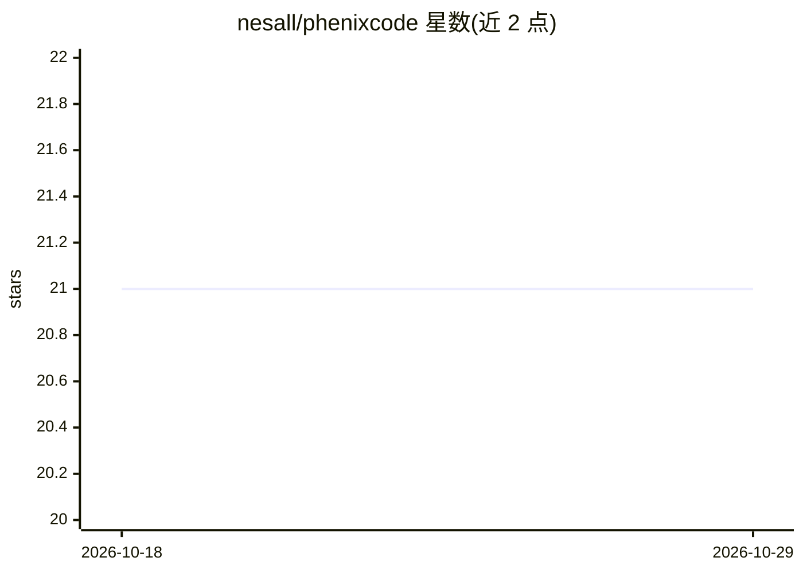

# nesall/phenixcode

⭐ 21 · C++ · MIT · 推送 2026-10-27 · [GitHub](https://github.com/nesall/phenixcode) · 个人维护

**自托管的代码库 RAG 问答助手，隐私优先，本地或云端模型可选**

面向开发者的自托管 RAG 系统：在本地索引代码库（AST/行级切片、HNSW 向量 + SQLite FTS5 BM25 混合检索、RRF 融合），提供桌面 UI、管理面板与 REST API，输出上下文感知的回答；内置亚毫秒级 C++ 查询分类器自动路由到不同模型档位。支持 llama-server、Ollama、vLLM 等本地运行时及 OpenAI/Anthropic/Mistral/xAI 云端 API，可完全离线运行。以预编译二进制发布，也可用 C++20/CMake/Node.js 自行构建。README 声明不做内联幽灵文本补全，定位为代码库问答与架构探索。

## 筛选速览

| 维度 | 判定 | 备注 |
|---|---|---|
| AI 角色 | `ai-native` | 本体是模型或模型工具 |
| 许可风险 | `permissive` | MIT |
| 部署形态 | `None` |  |
| 模型依赖 | local-ok | 支持本地模型 |
| 硬件要求 | — | 无带数字的原话,不猜 |
| 安装摩擦 | `medium` | 含编译或系统依赖之一 |
| 成熟度 | — | 结构信号不足 |

## 能力要点

- HNSW 向量 + SQLite FTS5 BM25 混合检索（RRF 融合）
- 嵌入式亚毫秒级查询自动路由器（免 LLM 分类开销）
- 本地（llama-server/Ollama/vLLM）与云端（OpenAI/Anthropic/Mistral/xAI）多供应商支持
- 内置检索评测套件（Recall@k/MRR/NDCG）与 FIM 代码补全 API

## 适用场景

- 在私有基础设施上对代码库做问答与架构探索
- 完全离线使用本地模型进行代码检索问答
- 通过 REST API 将代码问答接入自己的工作流

## 场景标签

`RAG` · 领域:知识与检索

## 证据(README 行号)

> L5: A self-hosted, privacy-first RAG and AI assistance system tailored for codebases. Index your code locally, perform h
> L47: * **Chat SPA & Native WebView:** Desktop GUI with Markdown table rendering, syntax highlighting, code-block copying
> L193: |`POST`|`/api/chat`|Streaming SSE endpoint for code completions and chat|

## 星数曲线

2026-10-18 21 → 2026-10-29 21（+0）

---
*卡片 v1 · prompt 1.4 · 生成 2026-10-28 · 置信度 high · 依据 README sha `bfd3e0f6a37c` · [字段定义](../../DATASET.md)*
