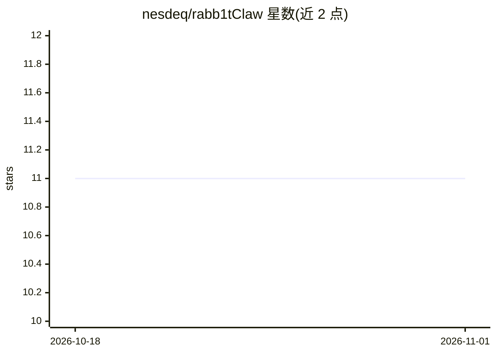

# nesdeq/rabb1tClaw

⭐ 11 · Rust · MIT · 推送 2026-07-30 · [GitHub](https://github.com/nesdeq/rabb1tClaw) · 个人维护

**面向 Rabbit R1 的自托管 Rust LLM 网关**

用 Rust（Tokio + Axum）实现 OpenClaw WebSocket 协议 v3，把 Rabbit R1 设备直连到 OpenAI、Anthropic、DeepInfra 或任意 OpenAI 兼容端点，流式响应逐 token 到达，可在 Raspberry Pi 上运行。对话流中实时拦截 LLM 发出的调度块并派发后台 agent：沙箱 Python 代码执行（hakoniwa Linux 命名空间）、5 阶段 Web 搜索（Serper.dev）、多步编排 agent 与记忆 agent。会话 AES-256-GCM 加密存储，提供 CLI 管理设备、provider 与模型，配置热重载。从源码 cargo build 安装，前置依赖 Rust、Python 3、passt 与内核配置。

## 筛选速览

| 维度 | 判定 | 备注 |
|---|---|---|
| AI 角色 | `ai-ecosystem` | LLM/agent 周边工具 |
| 许可风险 | `permissive` | MIT |
| 部署形态 | `None` |  |
| 模型依赖 | local-ok | 支持本地模型 |
| 硬件要求 | — | 无带数字的原话,不猜 |
| 安装摩擦 | `medium` | 含编译或系统依赖之一 |
| 成熟度 | — | 结构信号不足 |

## 能力要点

- 实现 OpenClaw WebSocket 协议 v3，R1 直连多 provider，支持并发设备连接
- 沙箱 Python 代码 agent（Linux 命名空间隔离，自愈重试）
- 5 阶段 LLM 驱动的 Web 搜索 agent（Serper.dev）
- 会话 AES-256-GCM 静态加密，密钥由设备 token 派生

## 适用场景

- 让 Rabbit R1 使用自己的 API key 和选择的模型，不经云中间层
- 在 Raspberry Pi 等低功耗设备上自建 R1 后端
- 通过语音对话触发代码执行、搜索与多步任务

## 场景标签

`模型网关` · 领域:Agent 开发

## 证据(README 行号)

> L10: **A native Rust LLM gateway for the Rabbit R1.** Sub-30-second setup. No cloud middleman. Your hardware, your model
> L12: rabb1tClaw implements the OpenClaw WebSocket protocol v3, giving your R1 a direct line to OpenAI, Anthropic, DeepIn

## 星数曲线

2026-10-18 11 → 2026-11-01 11（+0）

---
*卡片 v1 · prompt 1.4 · 生成 2026-11-01 · 置信度 high · 依据 README sha `427cadd8d1bf` · [字段定义](../../DATASET.md)*
