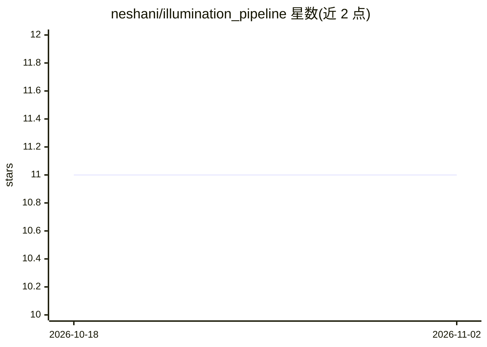

# neshani/illumination_pipeline

⭐ 11 · Python · MIT · 推送 2026-01-09 · [GitHub](https://github.com/neshani/illumination_pipeline) · 个人维护

**把 EPUB 电子书自动转为配图插画的本地 AI 命令行流水线**

Python 命令行工具，面向使用本地 AI 的电子书读者与 AI 绘图爱好者：解析 EPUB 提取文本，按可配置块分组后调用 OpenAI 兼容的本地 LLM（如 LM Studio）生成图像提示词，再批量发送到 SD Forge 或 ComfyUI 后端生图，并支持可断点续传的批量放大。全部设置经 JSON 配置驱动，支持自定义 ComfyUI 工作流注入提示词。需用户自行安装并运行本地 LLM 服务与图像后端，且需手工清理导入文本中的非正文内容。

## 筛选速览

| 维度 | 判定 | 备注 |
|---|---|---|
| AI 角色 | `ai-native` | 本体是模型或模型工具 |
| 许可风险 | `permissive` | MIT |
| 部署形态 | `library` | 以包/库形式分发 |
| 模型依赖 | — | README 未给出锁定关系 |
| 硬件要求 | — | 无带数字的原话,不猜 |
| 安装摩擦 | `low` | 无编译、无系统依赖或容器化 |
| 成熟度 | — | 结构信号不足 |

## 能力要点

- EPUB 解析与智能分块，控制插画数量与密度
- 接入任意 OpenAI 兼容本地 LLM 生成图像提示词
- 双后端支持 SD Forge 与 ComfyUI，批量生成与断点续传
- 自定义 ComfyUI 工作流通过占位符注入提示词

## 适用场景

- 把整本电子书自动配图生成系列插画
- 为遗漏场景单独补图或尝试不同构图
- 长批跑前用测试套件调优提示词模板与分块效果

## 场景标签

`图像生成` · 领域:内容生成

## 证据(README 行号)

> L9: It intelligently chunks the book's text, uses a local Large Language Model (LLM) to generate descriptive visual prom
> L17: - **Batch Image Generation:** Processes the entire list of prompts to generate hundreds of images in a single run.

## 星数曲线

2026-10-18 11 → 2026-11-02 11（+0）

---
*卡片 v1 · prompt 1.4 · 生成 2026-11-01 · 置信度 mid · 依据 README sha `510f6d6bce0e` · [字段定义](../../DATASET.md)*
