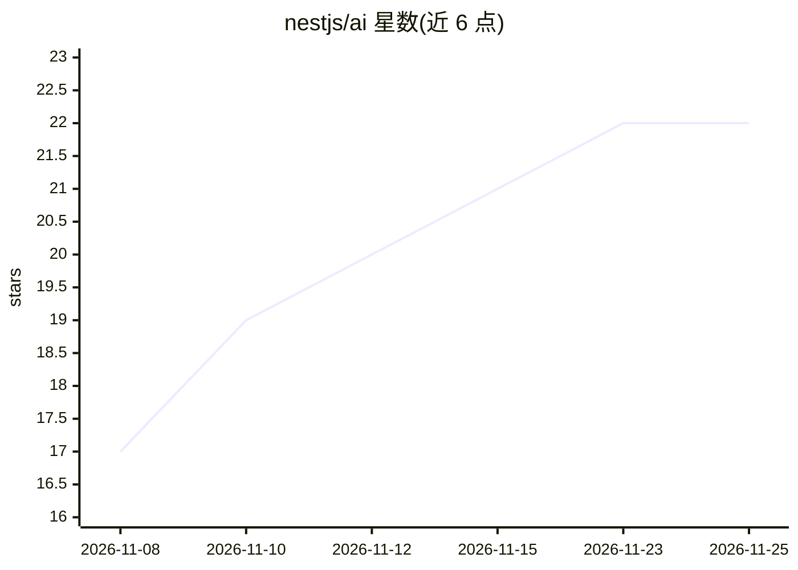

# nestjs/ai

⭐ 22 · TypeScript · MIT · 推送 2026-11-23 · [GitHub](https://github.com/nestjs/ai) · 组织维护

**Nest 框架的 AI 模块：依赖注入方式接入语言模型与构建 agent**

NestJS 官方生态的 AI 集成模块，基于 Vercel AI SDK 构建：通过命名模型与依赖注入调用语言模型，提供超时、重试、fallback 模型、预算与用量事件，支持 schema 校验的结构化输出、流式响应（Express/Fastify/Node 适配器），以及基于 @nestjs/workflows 的可持久化 agent 运行。应用自身方法可经 @AgentFunction() 暴露为 agent 工具，或经 @nestjs/mcp 暴露为 MCP 工具，调用会经过 guards/interceptors/pipes 等上下文管线并可接入认证授权。内置测试用假模型。面向 Nest 开发者，需 Node.js 22+、Zod 4.2+。

## 筛选速览

| 维度 | 判定 | 备注 |
|---|---|---|
| AI 角色 | `ai-ecosystem` | LLM/agent 周边工具 |
| 许可风险 | `permissive` | MIT |
| 部署形态 | `library` | 以包/库形式分发 |
| 模型依赖 | — | README 未给出锁定关系 |
| 硬件要求 | — | 无带数字的原话,不猜 |
| 安装摩擦 | `low` | 无编译、无系统依赖或容器化 |
| 成熟度 | — | 结构信号不足 |

## 能力要点

- 命名语言模型/嵌入模型的依赖注入与弹性调用（超时、重试、fallback、预算）
- @AgentFunction() 将应用方法暴露为 agent 工具，经 Nest 管线并可认证授权
- 基于 @nestjs/workflows 的持久化 agent 运行，重启存活并支持人工审批
- 附 FakeModel/FakeEmbedding 测试模型，无需网络

## 适用场景

- 在 Nest 应用中以 DI 方式接入 Claude/OpenAI/Google 等模型并做结构化输出
- 将业务方法同时暴露为 agent 工具与 MCP 工具
- 构建带流式响应与人工审批的持久化 agent 流程

## 场景标签

`Agent 框架` `模型网关` · 领域:Agent 开发

## 证据(README 行号)

> L14: Language models for Nest: named models through dependency injection, model calls with timeouts, retries and fallbac
> L19: $ npm i --save @nestjs/ai @nestjs/resilience ai @ai-sdk/anthropic zod
> L39: The sample is a cat store: it triages support emails, and runs a chat assistant that calls the same `find-order` me

## 星数曲线

2026-11-08 17 → 2026-11-25 22（+5）

---
*卡片 v1 · prompt 1.4 · 生成 2026-11-18 · 置信度 high · 依据 README sha `f7504a09fa21` · [字段定义](../../DATASET.md)*
