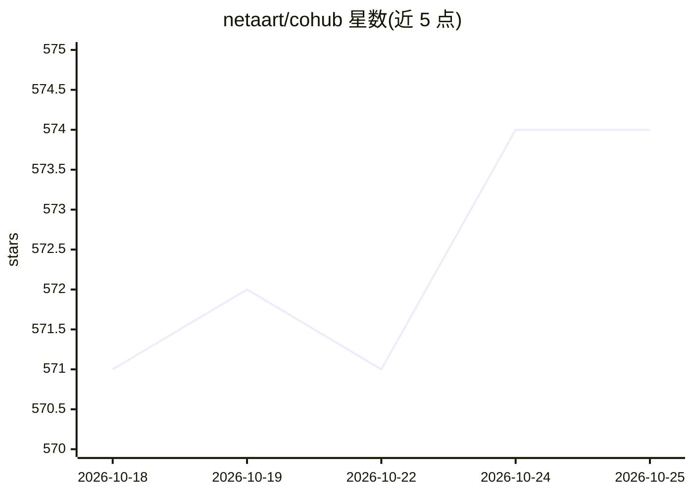

# netaart/cohub

⭐ 575 · TypeScript · Apache-2.0 · 推送 2026-10-25 · [GitHub](https://github.com/netaart/cohub) · [官网](https://cohub.live) · 组织维护 · 中文 README

**人与 agent 共同创作、游玩和构建的在线协作空间平台**

Cohub 提供名为 Space 的项目空间：用户在其中结合提示词、文件与 agent 进行创作，产出游戏、应用、媒体、自动化等成品，支持保存与分享。Space 可通过 Web、iOS/Android 应用、CLI、Discord、微信等多个入口访问，并支持 fork 检查点或以 @space 引用其他 Space 作为上下文。产品由 Viscept Limited 以 Apache 2.0 开发，核心开发流程在公开 Space 中进行，提供 CLI 安装与自托管文档。

## 筛选速览

| 维度 | 判定 | 备注 |
|---|---|---|
| AI 角色 | `ai-native` | 本体是模型或模型工具 |
| 许可风险 | `permissive` | Apache-2.0 |
| 部署形态 | `library` | 以包/库形式分发 |
| 模型依赖 | — | README 未给出锁定关系 |
| 硬件要求 | — | 无带数字的原话,不猜 |
| 安装摩擦 | `low` | 无编译、无系统依赖或容器化 |
| 成熟度 | — | 结构信号不足 |

## 能力要点

- Space 中人与 agent 协同创建游戏、应用、媒体、自动化等成品
- Web、移动端、CLI、Discord、微信多端访问同一 Space
- 支持 fork 检查点与 @space 引用其他 Space 作为上下文
- 可自托管，agent 运行时基于 pi 构建

## 适用场景

- 在同一个空间里和 agent 一起从想法迭代出可用的应用或游戏
- 在手机、CLI 或微信等不同入口继续同一个项目空间
- 团队或公司内部用 Space 组织 agent 参与的开发与创作流程

## 场景标签

`AI 助手` · 领域:对话与助手

## 证据(README 行号)

> L12: **A living space where people and agents create, play, and build together.**
> L15: - **Build together** — People and agents in one Space. Create together, save, and share.

## 星数曲线

2026-10-18 571 → 2026-10-25 574（+3）

---
*卡片 v1 · prompt 1.4 · 生成 2026-10-21 · 置信度 mid · 依据 README sha `724d607ea0b2` · [字段定义](../../DATASET.md)*
