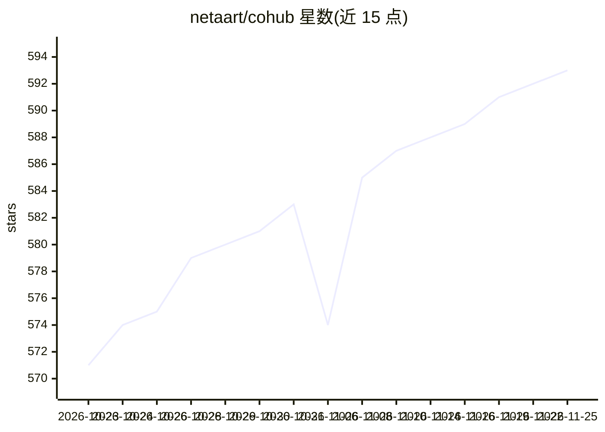

# netaart/cohub

⭐ 593 · TypeScript · Apache-2.0 · 推送 2026-11-23 · [GitHub](https://github.com/netaart/cohub) · [官网](https://cohub.live) · 组织维护 · 中文 README

**人与 agent 共同创作、分享的在线协作空间**

Cohub 提供以 Space 为单位的协作环境，用户与 agent 在同一空间内处理想法、提示词、文件并共同产出游戏、应用、媒体、自动化等内容；支持 Fork checkpoint 到新 Space、用 `@space` 引用其他 Space 作为上下文。可通过 Web、移动端、CLI、Discord、微信访问，提供 self-host 方案与 agent skills 集成（Antigravity、Claude Code、Codex、Cursor 等）。其 agent 运行时基于 pi 构建，开发流程本身在公开 Space 中进行。

## 筛选速览

| 维度 | 判定 | 备注 |
|---|---|---|
| AI 角色 | `ai-native` | 本体是模型或模型工具 |
| 许可风险 | `permissive` | Apache-2.0 |
| 部署形态 | `library` | 以包/库形式分发 |
| 模型依赖 | — | README 未给出锁定关系 |
| 硬件要求 | — | 无带数字的原话,不猜 |
| 安装摩擦 | `low` | 无编译、无系统依赖或容器化 |
| 成熟度 | — | 结构信号不足 |

## 能力要点

- 人与 agent 同处一个 Space 共同创建、保存与分享内容
- checkpoint Fork 与 `@space` 引用提供上下文复用机制
- 多端访问：Web、iOS/Android、CLI、Discord、微信
- 提供 self-host 部署与 agent skills 安装方式

## 适用场景

- 与 agent 协作开发小型应用或游戏
- 把已有 Space 作为上下文 Fork 出新项目
- 通过 CLI 在终端接入 Cohub Space
- 公司内部以 Space 承载 specs、评审与发布流程

## 场景标签

`编码 Agent` `AI 助手` · 领域:编码与开发

## 证据(README 行号)

> L12: **A living space where people and agents create, play, and build together.**
> L15: - **Build together** — People and agents in one Space. Create together, save, and share.
> L68: Cohub's agent runtime is built on pi — thank you for the foundation.

## 星数曲线

2026-10-23 571 → 2026-11-25 593（+22）

---
*卡片 v1 · prompt 1.4 · 生成 2026-11-25 · 置信度 mid · 依据 README sha `b3d3ca7084fc` · [字段定义](../../DATASET.md)*
