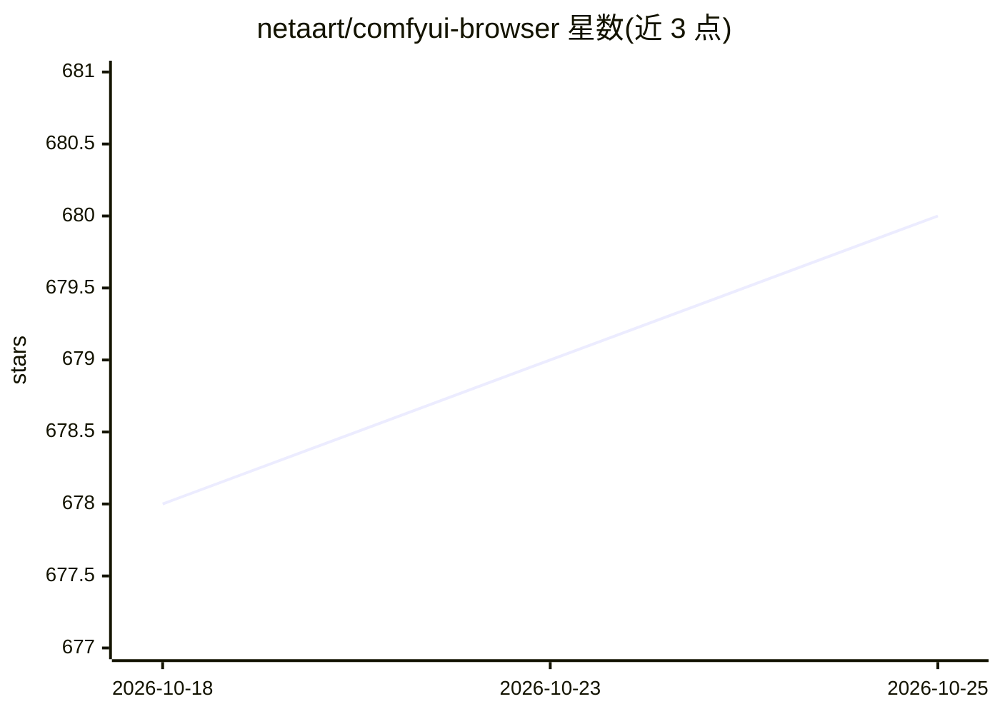

# netaart/comfyui-browser

⭐ 680 · Svelte · 推送 2026-08-09 · [GitHub](https://github.com/netaart/comfyui-browser) · 个人维护 · 中文 README

**ComfyUI 的图像/视频/工作流浏览器与管理插件**

作为 ComfyUI 的自定义节点插件运行：浏览并管理输出目录中的图像、视频与工作流，通过 'Saves' 收藏工作流并用 Git 同步到远程仓库实现多机使用；可订阅 Git 工作流源并按关键词搜索；附带 xyz_plot、inputs_select 等自定义节点。通过 ComfyUI Manager 搜索安装，或手动克隆到 custom_nodes 目录。前端用 Svelte 编写，后端基于 aiohttp，可覆盖 config.json 自定义目录路径。

## 筛选速览

| 维度 | 判定 | 备注 |
|---|---|---|
| AI 角色 | `ai-ecosystem` | LLM/agent 周边工具 |
| 许可风险 | `none` | — |
| 部署形态 | `library` | 以包/库形式分发 |
| 模型依赖 | — | README 未给出锁定关系 |
| 硬件要求 | — | 无带数字的原话,不猜 |
| 安装摩擦 | `low` | 无编译、无系统依赖或容器化 |
| 成熟度 | — | 结构信号不足 |

## 能力要点

- 浏览与管理输出目录中的图像/视频/工作流
- 通过 Git 同步 'Saves' 收藏并订阅外部工作流源
- 附带 xyz_plot、inputs_select 自定义节点
- 支持 config.json 覆盖 collections/sources/outputs 目录

## 适用场景

- 管理 ComfyUI 生成的图像与视频输出
- 跨设备同步和复用收藏的工作流
- 从外部 Git 源订阅并加载工作流

## 场景标签

 · 领域:图像生成/工具插件

## 证据(README 行号)

> L7: This is an image/video/workflow browser and manager for ComfyUI.
> L96: Clone this repo into the `custom_nodes` folder and restart the ComfyUI.

## 星数曲线

2026-10-18 678 → 2026-10-25 680（+2）

---
*卡片 v1 · prompt 1.4 · 生成 2026-10-21 · 置信度 mid · 依据 README sha `b0346dec6922` · [字段定义](../../DATASET.md)*
