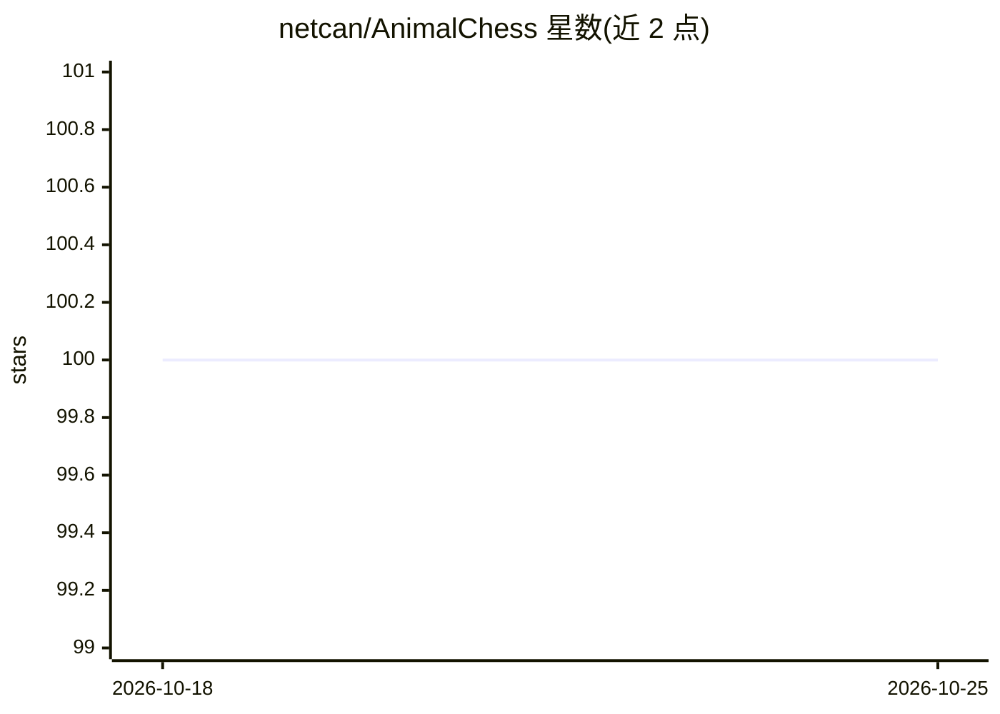

# netcan/AnimalChess

⭐ 100 · Rust · MIT · 推送 2026-06-12 · [GitHub](https://github.com/netcan/AnimalChess) · [官网](https://netcan.github.io/2020/06/07/%E7%94%A8Rust%E5%86%99%E4%B8%80%E4%B8%AA%E6%96%97%E5%85%BD%E6%A3%8B%E6%B8%B8%E6%88%8F/) · 个人维护

**Rust 编写的斗兽棋游戏，内置 AI 对弈与 AlphaZero 训练**

用 Rust 实现的斗兽棋（Animal Fight Chess）桌面游戏：棋盘与 GUI 基于 sdl2，对战目标是把任一棋子移入对方兽穴。内置 Alpha-Beta 剪枝算法作为 AI 对手，并实现 AlphaZero 算法用于训练，Todo 列表显示已加入蒙特卡洛树搜索。运行需 Rust nightly 工具链，通过 git clone 源码后 cargo run 启动；开发 AlphaZero 相关功能需安装 python3-dev 并使用 pymodule 下的 Python 虚拟环境。

## 筛选速览

| 维度 | 判定 | 备注 |
|---|---|---|
| AI 角色 | `ai-enhanced` | 去掉 AI 部分产品仍成立 |
| 许可风险 | `permissive` | MIT |
| 部署形态 | `library` | 以包/库形式分发 |
| 模型依赖 | — | README 未给出锁定关系 |
| 硬件要求 | — | 无带数字的原话,不猜 |
| 安装摩擦 | `low` | 无编译、无系统依赖或容器化 |
| 成熟度 | — | 结构信号不足 |

## 能力要点

- Alpha-Beta 剪枝算法实现 AI 对弈
- 实现 AlphaZero 算法用于训练
- 已加入蒙特卡洛树搜索算法
- 导出 Python3 模块（pymodule）供开发

## 适用场景

- 与内置 AI 对手玩斗兽棋
- 了解/修改 AlphaZero 在棋类游戏上的训练实现
- 基于 Python 模块做算法实验

## 场景标签

`强化学习` · 领域:训练与推理

## 证据(README 行号)

> L2: Animal Fight Chess Game（斗兽棋） written in rust, using Alpha-Beta-Pruning algorithm, and implement AlphaZero algorithm 
> L37: - [x] Add `Monte Carlo Tree Search` Algorithm

## 星数曲线

2026-10-18 100 → 2026-10-25 100（+0）

---
*卡片 v1 · prompt 1.4 · 生成 2026-10-23 · 置信度 mid · 依据 README sha `cc609df52a7a` · [字段定义](../../DATASET.md)*
