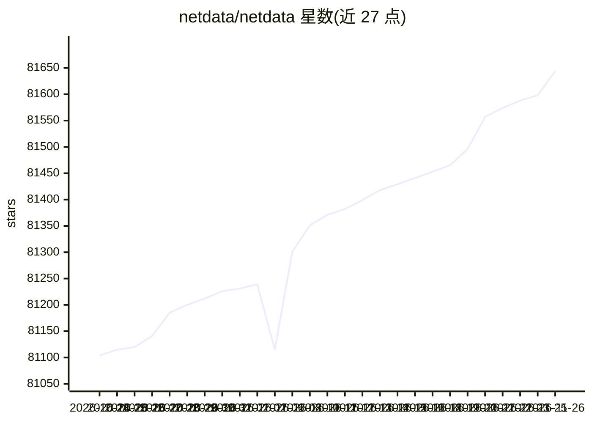

# netdata/netdata

⭐ 81,644 · Go · GPL-3.0 · 推送 2026-11-25 · [GitHub](https://github.com/netdata/netdata) · [官网](https://www.netdata.cloud) · 组织维护

**给基础设施与应用团队的全栈可观测性监控平台**

Netdata 是分布式实时可观测性平台：Agent 在数据产生处按秒采集、存储、分析并告警，覆盖指标、日志、追踪、网络流、拓扑、APM、数字体验与云服务，通过 2000+ 集成监控 10 万+ 节点。每个指标由机器学习做异常检测，异常聚类用于根因与影响分析；内置 MCP server 可向任意 AI 助手提供证据。Agent 为开源 GPL v3+，Netdata Cloud 提供 SaaS 或企业本地部署及免费社区版，UI 经 CDN 分发。

## 筛选速览

| 维度 | 判定 | 备注 |
|---|---|---|
| AI 角色 | `ai-enhanced` | 去掉 AI 部分产品仍成立 |
| 许可风险 | `viral` | GPL-3.0 |
| 部署形态 | `None` |  |
| 模型依赖 | — | README 未给出锁定关系 |
| 硬件要求 | — | 无带数字的原话,不猜 |
| 安装摩擦 | `low` | 无编译、无系统依赖或容器化 |
| 成熟度 | — | 结构信号不足 |

## 动量与使用信号

- 维护:`active` — 距上次 push 0.6 天,年发版 17,402 位贡献者
- 涨星:近 1 天 **+14**(自 20261016 起算)
- 平台:LINUX · 协议:—

## 能力要点

- 每秒采集并对每个指标做机器学习异常检测
- 2,000+ 集成覆盖系统、容器、K8s、数据库、云服务
- 内置 MCP server，向任意 AI 助手提供排查证据
- 支持 S3 日志 offload、分层存储约 0.6 字节/样本

## 适用场景

- 监控服务器、容器和 Kubernetes 集群的实时指标与日志
- 为基础设施和应用配置告警与通知集成
- 用异常检测与根因分析排查线上故障
- 通过 SNMP/NetFlow 监控网络设备与流量

## 场景标签

 · 领域:运维监控/可观测性

## 证据(README 行号)

> L45: Netdata is a full-stack observability platform: infrastructure, application performance monitoring (OpenTelemetry t
> L56: * **AI at the core** – Machine learning, a scoring engine and AI work together to deliver automated root-cause and 
> L98: |**Netdata Agent**|• Core engine: collection, storage, machine learning, alerting, streaming, export • Also a hub: 

## 星数曲线

2026-10-24 81,104 → 2026-11-26 81,644（+540）

---
*卡片 v1 · prompt 1.4 · 生成 2026-11-22 · 置信度 high · 依据 README sha `575791e04fd5` · [字段定义](../../DATASET.md)*
