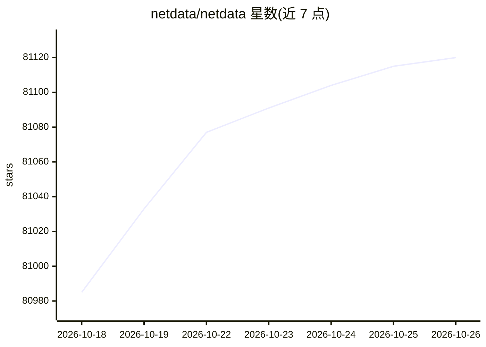

# netdata/netdata

⭐ 81,120 · Go · GPL-3.0 · 推送 2026-10-25 · [GitHub](https://github.com/netdata/netdata) · [官网](https://www.netdata.cloud) · 组织维护

**为基础设施团队提供每秒级实时监控与 ML 异常检测**

Netdata 是开源实时基础设施监控平台，Agent 部署在被监控节点上执行采集、存储、边缘 ML 训练与告警，覆盖系统资源、存储、网络、容器、虚拟机、日志、云服务与 800+ 集成；采用 Parent-Child 架构实现集中化与横向扩展，可选连接 Netdata Cloud 获得多节点视图与 RBAC，数据保留在本地基础设施。存储约 0.5 字节/样本，生产环境默认资源占用约 5% CPU、150MiB RAM。

## 筛选速览

| 维度 | 判定 | 备注 |
|---|---|---|
| AI 角色 | `ai-enhanced` | 去掉 AI 部分产品仍成立 |
| 许可风险 | `viral` | GPL-3.0 |
| 部署形态 | `None` |  |
| 模型依赖 | — | README 未给出锁定关系 |
| 硬件要求 | — | 无带数字的原话,不猜 |
| 安装摩擦 | `low` | 无编译、无系统依赖或容器化 |
| 成熟度 | — | 结构信号不足 |

## 动量与使用信号

- 维护:`active` — 距上次 push 0.6 天,年发版 17,402 位贡献者
- 涨星:近 1 天 **+14**(自 20261016 起算)
- 平台:LINUX · 协议:—

## 能力要点

- 每秒级指标采集与实时可视化（1 秒延迟）
- 边缘训练 ML 模型做每指标无监督异常检测
- 800+ 集成，自动发现节点上的指标
- 指标可导出至 Prometheus、InfluxDB、OpenTSDB、Graphite 等

## 适用场景

- 监控服务器、容器与 Kubernetes 集群的实时性能
- 无需中心化采集地保留监控数据在本地
- 通过内置 ML 自动发现指标异常
- 把多节点指标导出到既有时间序列数据库

## 场景标签

 · 领域:DevOps/可观测性

## 证据(README 行号)

> L42: Netdata is an open-source, real-time infrastructure monitoring platform. Monitor, detect, and act across your entir
> L83: |**ML-Powered**|Unsupervised anomaly detection|Trains multiple ML models per metric at the edge|
> L232: |**Edge-Based ML**|• ML models trained at the edge • Automatic anomaly detection per metric • Pattern recognition 

## 星数曲线

2026-10-18 80,985 → 2026-10-26 81,120（+135）

---
*卡片 v1 · prompt 1.4 · 生成 2026-10-18 · 置信度 high · 依据 README sha `33b770a937ec` · [字段定义](../../DATASET.md)*
