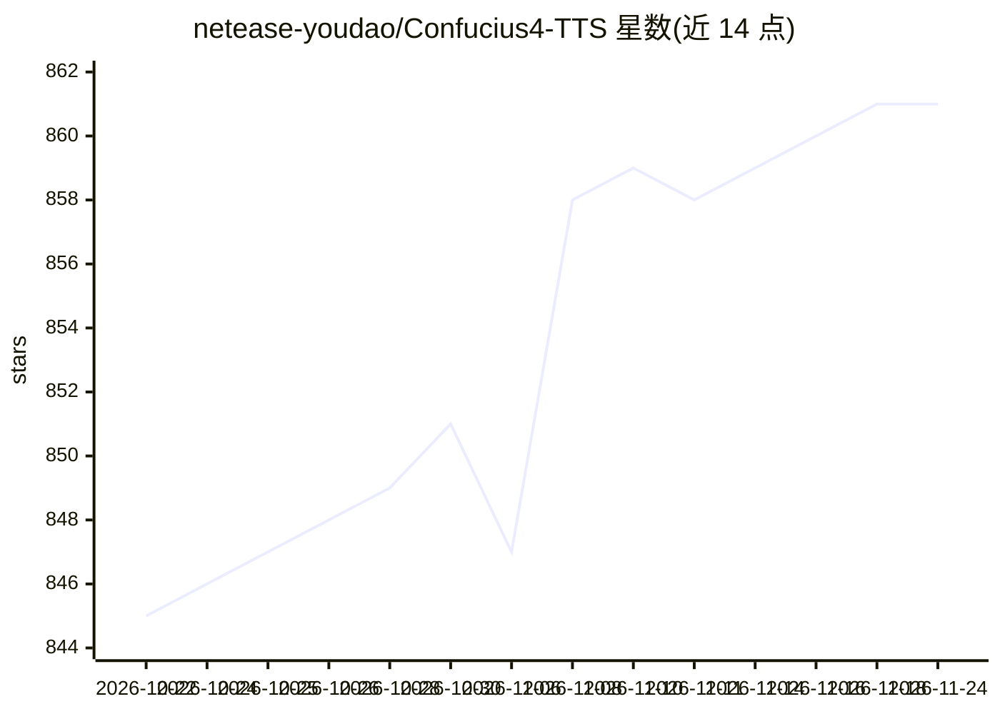

# netease-youdao/Confucius4-TTS

⭐ 861 · Python · NOASSERTION · 推送 2026-11-04 · [GitHub](https://github.com/netease-youdao/Confucius4-TTS) · 组织维护

**多语种零样本 TTS 引擎：一句话克隆声音跨 14 语言合成**

基于语音编码器 + LLM 架构的零样本语音合成系统，支持 14 种语言与跨语种声音迁移，无需参考转写文本即可克隆音色，并提供情感迁移。推理路径含 Transformers 基础版与 vLLM 加速的 T2S 阶段（支持流式），提供 Gradio Web UI 与 FastAPI 服务端点。另开放微调管线（Text2Semantic 与 Semantic2Acoustic 两模块），训练时冻结 T2S 主干与编码器。依赖 Python 3.10 与 CUDA 12.6，需自行准备外部预训练模型。

## 筛选速览

| 维度 | 判定 | 备注 |
|---|---|---|
| AI 角色 | `ai-native` | 本体是模型或模型工具 |
| 许可风险 | `none` | NOASSERTION |
| 部署形态 | `library` | 以包/库形式分发 |
| 模型依赖 | local-ok | 支持本地模型 |
| 硬件要求 | — | 无带数字的原话,不猜 |
| 安装摩擦 | `medium` | 含编译或系统依赖之一 |
| 成熟度 | — | 结构信号不足 |

## 能力要点

- 14 种语言零样本语音克隆，无需参考转写文本
- 跨语种迁移：同一声音在 14 语言间切换合成
- vLLM 后端加速 T2S 自回归阶段，支持流式与非流式输出
- 开放 T2S/S2A 两模块微调管线

## 适用场景

- 用一段参考音频克隆声音并生成多语言语音
- 通过 FastAPI 接口在自己的服务中集成 TTS 能力
- 为多语种场景微调自有音色的合成模型
- 浏览器内交互式试做零样本声音克隆

## 场景标签

`语音合成` `微调` · 领域:内容生成

## 证据(README 行号)

> L19: Confucius4-TTS is an advanced LLM-based text-to-speech (TTS) system designed for multilingual and cross-lingual spe
> L23: - **14 Languages Supported**: Chinese, English, Japanese, Korean, German, French, Spanish, Indonesian, Italian, Tha
> L105: The basic path above runs the Text2Semantic (T2S) autoregressive stage with HuggingFace Transformers. For faster T

## 星数曲线

2026-10-22 845 → 2026-11-24 861（+16）

---
*卡片 v1 · prompt 1.4 · 生成 2026-11-24 · 置信度 high · 依据 README sha `309b3fe62b4e` · [字段定义](../../DATASET.md)*
