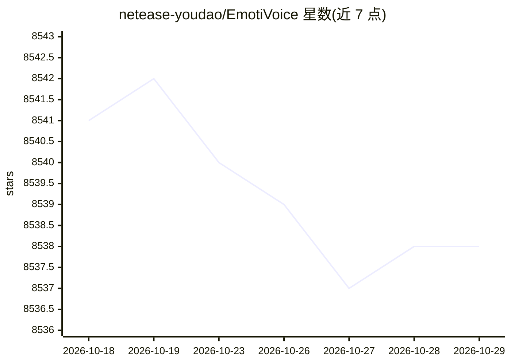

# netease-youdao/EmotiVoice

⭐ 8,538 · Python · Apache-2.0 · 推送 2026-09-03 · [GitHub](https://github.com/netease-youdao/EmotiVoice) · 组织维护 · 中文 README

**面向开发者的中英双语多音色情感 TTS 引擎**

网易有道开源的文本转语音引擎，支持中英文、2000+ 音色与情感/风格提示控制（开心、悲伤、愤怒等），可克隆个人声音（DataBaker/LJSpeech Recipe）。提供 Web 界面、批量脚本接口和 OpenAI 兼容 TTS API；最简运行方式为 Docker 镜像（需 NVidia GPU 与 container toolkit），完整安装需 conda 环境、PyTorch 及从 ModelScope/Hugging Face 下载预训练模型。训练数据含 LibriTTS/HiFiTTS，Apache-2.0 许可。

## 筛选速览

| 维度 | 判定 | 备注 |
|---|---|---|
| AI 角色 | `ai-native` | 本体是模型或模型工具 |
| 许可风险 | `permissive` | Apache-2.0 |
| 部署形态 | `self-host` | docker 或自建部署 |
| 模型依赖 | — | README 未给出锁定关系 |
| 硬件要求 | — | 无带数字的原话,不猜 |
| 安装摩擦 | `low` | 无编译、无系统依赖或容器化 |
| 成熟度 | — | 结构信号不足 |

## 能力要点

- 2000+ 音色与情感/风格提示控制的语音合成
- 提供 Docker 镜像、Web 界面与批量脚本接口
- OpenAI 兼容 TTS API，支持语速调节
- 支持用个人数据做声音克隆

## 适用场景

- 为应用生成带情感的中英文语音
- 批量合成带指定音色与情绪的音频内容
- 通过 OpenAI 兼容 API 接入现有 TTS 调用链
- 用自己的数据克隆声音

## 场景标签

`语音合成` · 领域:内容生成

## 证据(README 行号)

> L12: **EmotiVoice** is a powerful and modern open-source text-to-speech engine that is available to you at no cost. Emot
> L4:  EmotiVoice 😊: a Multi-Voice and Prompt-Controlled TTS Engine

## 星数曲线

2026-10-18 8,541 → 2026-10-29 8,538（-3）

---
*卡片 v1 · prompt 1.4 · 生成 2026-10-20 · 置信度 high · 依据 README sha `1ef6814becf3` · [字段定义](../../DATASET.md)*
