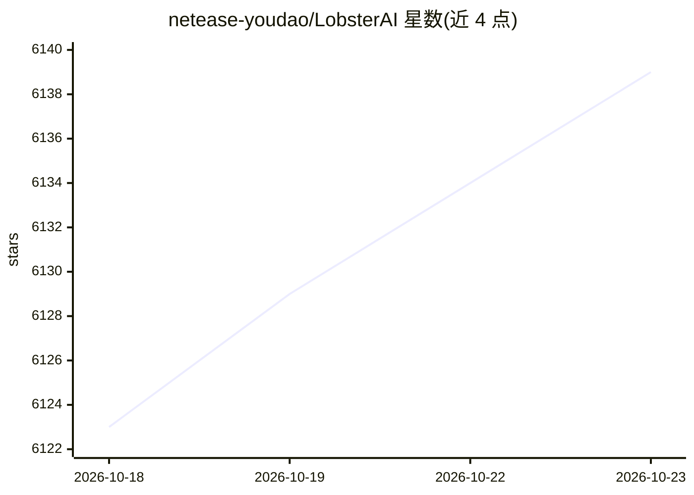

# netease-youdao/LobsterAI

⭐ 6,139 · TypeScript · MIT · 推送 2026-10-22 · [GitHub](https://github.com/netease-youdao/LobsterAI) · [官网](https://lobsterai.youdao.com) · 组织维护 · 中文 README

**网易有道开源的桌面级办公 Agent，操作本机文件与办公软件**

基于 Electron 的桌面 Agent 应用：通过会话驱动 Agent 操作本地文件、终端、浏览器、文档、表格与幻灯片，内置 28 个技能（网络搜索、Word/Excel/PPT 处理、PDF、Remotion 视频生成、图像视频生成等），支持自定义多 Agent、MCP 服务器接入、定时任务与通过微信/企业微信/飞书/钉钉/Telegram 等 IM 远程下发指令。执行层由 OpenClaw 运行时承担，会话与数据以 SQLite 本地存储，敏感操作前请求批准。提供 macOS/Windows 安装包，也可从源码构建。

## 筛选速览

| 维度 | 判定 | 备注 |
|---|---|---|
| AI 角色 | `ai-native` | 本体是模型或模型工具 |
| 许可风险 | `permissive` | MIT |
| 部署形态 | `desktop` | 安装包/桌面程序 |
| 模型依赖 | — | README 未给出锁定关系 |
| 硬件要求 | — | 无带数字的原话,不猜 |
| 安装摩擦 | `low` | 无编译、无系统依赖或容器化 |
| 成熟度 | — | 结构信号不足 |

## 能力要点

- 28 个内置技能，覆盖文档、表格、PPT、PDF、视频生成与浏览器自动化
- OpenClaw 作为运行时与网关，桌面端保留会话、记忆与 IM 绑定
- 微信/飞书/钉钉/Telegram 等 12 类 IM 渠道远程控制桌面 Agent
- MCP 服务器接入、定时任务、专家套件与多 Agent 配置

## 适用场景

- 让桌面 Agent 处理本地 Excel 数据分析并生成看板
- 通过微信或飞书在手机上给办公室电脑的 Agent 下达任务
- 定时收集资讯、监控网站并生成日报

## 场景标签

`AI 助手` `GUI 自动化` `浏览器自动化` `数据分析` · 领域:效率与自动化

## 证据(README 行号)

> L28: LobsterAI is a desktop Agent that can operate in your real working environment: local files, terminal commands, bro
> L48: LobsterAI ships with 28 built-in skills configured in `SKILLs/skills.config.json`, including web search, Word docum

## 星数曲线

2026-10-18 6,123 → 2026-10-23 6,139（+16）

---
*卡片 v1 · prompt 1.4 · 生成 2026-10-20 · 置信度 high · 依据 README sha `62a0c87c9741` · [字段定义](../../DATASET.md)*
