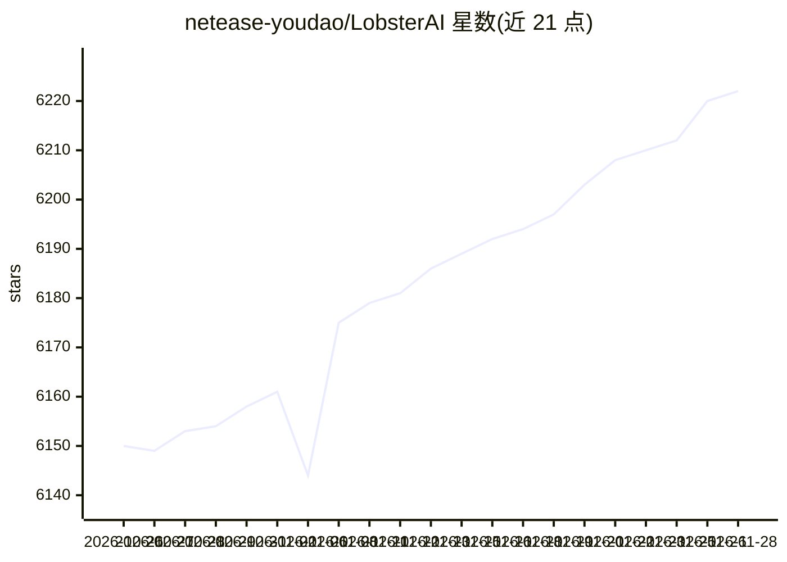

# netease-youdao/LobsterAI

⭐ 6,222 · TypeScript · MIT · 推送 2026-11-27 · [GitHub](https://github.com/netease-youdao/LobsterAI) · [官网](https://lobsterai.youdao.com) · 组织维护 · 中文 README

**桌面级开源 AI agent，帮用户在真实电脑上完成数据分析、文档与自动化任务**

网易有道开源的 Electron 桌面应用，基于打包的 DeepSeek Harness（DSH）运行时。用户用自然语言描述任务，agent 在本机读写文件、运行脚本、驱动浏览器、编辑 Word/Excel/PowerPoint 并交付结果。支持权限预设与交互审批、SQLite 定时任务、多 agent 委派、MCP 服务器与 Kits/Skills 扩展，并可通过微信、企业微信、飞书、钉钉、QQ、Telegram、Discord 从手机下发指令。提供 macOS/Windows 安装包，也可从源码构建。

## 筛选速览

| 维度 | 判定 | 备注 |
|---|---|---|
| AI 角色 | `ai-native` | 本体是模型或模型工具 |
| 许可风险 | `permissive` | MIT |
| 部署形态 | `desktop` | 安装包/桌面程序 |
| 模型依赖 | local-ok | 支持本地模型 |
| 硬件要求 | — | 无带数字的原话,不猜 |
| 安装摩擦 | `low` | 无编译、无系统依赖或容器化 |
| 成熟度 | — | 结构信号不足 |

## 能力要点

- 原生 Office 文档（docx/xlsx/pptx）应用内实时编辑，agent 可与人协同修改
- 多 IM 渠道远程控制桌面 agent，定时任务自动投递结果
- 多 agent 委派、MCP 连接器、Kits/Skills 与 DSH 插件生态
- 内置浏览器驱动、GUI 自动化（computer use）与语音输入

## 适用场景

- 用 Excel 库存数据生成可视化看板并总结增长驱动
- 每天定时抓取新闻生成摘要并推送到聊天软件
- 批量筛选简历并生成初选清单
- 研究某主题并直接产出演示文稿

## 场景标签

`AI 助手` `数据分析` `GUI 自动化` `多智能体` · 领域:Agent 开发

## 证据(README 行号)

> L5: **The open-source desktop AI agent that does real work on your computer.**
> L75: |**Models**|Built-in models (DeepSeek, Kimi, Qwen, GLM, MiniMax, and more) after sign-in, or bring your own API key
> L112: - **DeepSeek Harness (DSH)** runs the agent as an offline-complete bundled runtime (`@deepseek-ai/dsh`, pinned in 

## 星数曲线

2026-10-26 6,150 → 2026-11-28 6,222（+72）

---
*卡片 v1 · prompt 1.4 · 生成 2026-11-28 · 置信度 high · 依据 README sha `44e47a1d6fd4` · [字段定义](../../DATASET.md)*
