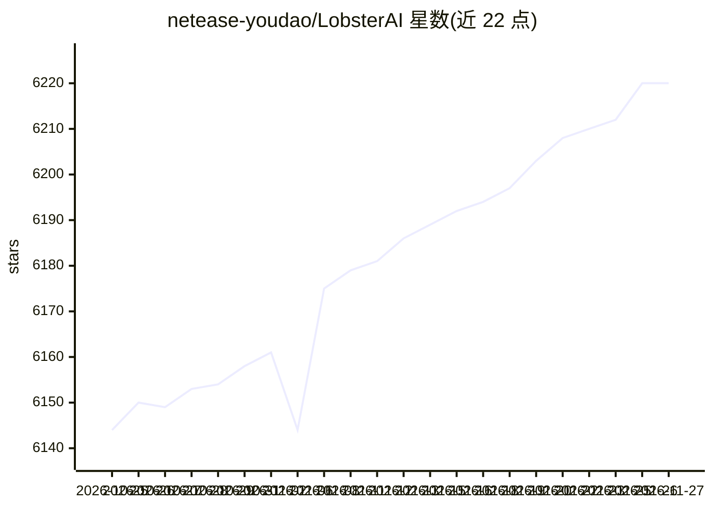

# netease-youdao/LobsterAI

⭐ 6,220 · TypeScript · MIT · 推送 2026-11-26 · [GitHub](https://github.com/netease-youdao/LobsterAI) · [官网](https://lobsterai.youdao.com) · 组织维护 · 中文 README

**开源桌面 AI agent：帮你完成数据分析、文档、幻灯片等实际工作**

网易有道开源的桌面级 AI agent 应用（macOS/Windows，Electron 构建），用自然语言下达任务后读取本地文件、运行工具、操控浏览器、编辑 Word/Excel/PowerPoint 并产出成品。底层基于 OpenClaw agent 运行时，会话与数据本地存储于 SQLite；文件、shell、网络操作均需审批确认。支持定时任务、多 agent、MCP 连接器，并可通过微信、飞书、钉钉、Telegram 等 IM 从手机远程下发任务。提供安装包下载，也可从源码构建。

## 筛选速览

| 维度 | 判定 | 备注 |
|---|---|---|
| AI 角色 | `ai-native` | 本体是模型或模型工具 |
| 许可风险 | `permissive` | MIT |
| 部署形态 | `library` | 以包/库形式分发 |
| 模型依赖 | local-ok | 支持本地模型 |
| 硬件要求 | — | 无带数字的原话,不猜 |
| 安装摩擦 | `low` | 无编译、无系统依赖或容器化 |
| 成熟度 | — | 结构信号不足 |

## 能力要点

- 本地会话存储于 SQLite，文件/shell/网络操作审批门控
- 原生编辑 Word/Excel/PowerPoint，产物支持 HTML/PDF/图片等实时预览
- 绑定微信、飞书、钉钉、Telegram 等 IM 通道远程下发任务
- 内置浏览器由 agent 驱动，支持定时循环任务与 MCP 服务器接入

## 适用场景

- 让 agent 读取本地 Excel 数据并生成可视化仪表盘
- 每天定时抓取新闻或检查网页数据面板并汇总
- 把简历文件夹筛成候选清单并与 JD 匹配
- 通过手机聊天软件远程给桌面 agent 派活

## 场景标签

`AI 助手` `数据分析` `浏览器自动化` · 领域:效率与自动化

## 证据(README 行号)

> L5: **The open-source desktop AI agent that does real work on your computer.**
> L7: Describe a task in plain language. LobsterAI reads your files, runs tools, drives a browser,
> L40: Built by NetEase Youdao, LobsterAI is the first open-source desktop-grade agent from a major Chinese tech company.

## 星数曲线

2026-10-25 6,144 → 2026-11-27 6,220（+76）

---
*卡片 v1 · prompt 1.4 · 生成 2026-11-22 · 置信度 high · 依据 README sha `9ecf4f085142` · [字段定义](../../DATASET.md)*
