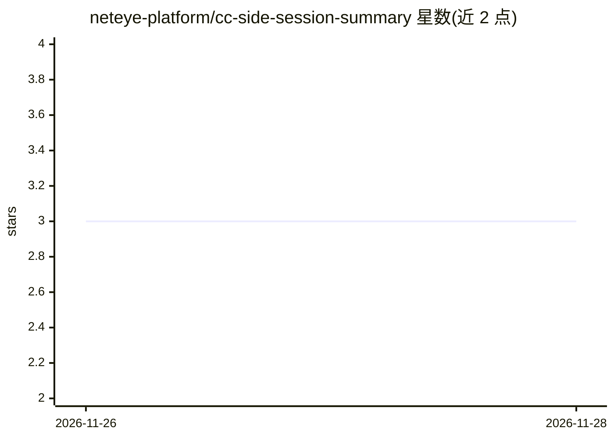

# neteye-platform/cc-side-session-summary

⭐ 3 · TypeScript · Apache-2.0 · 推送 2026-11-27 · [GitHub](https://github.com/neteye-platform/cc-side-session-summary) · 组织维护

**为 Claude Code 提供实时侧边栏：会话目标、进度清单与用量统计**

一个 Claude Code mod 插件，在会话旁保持一个实时侧边面板，显示模型行（当前模型与推理强度）、上下文 token 占用与成本、git worktree 状态、会话目标、颜色编码的进度清单与当前工作摘要。机制上注册 set_status 工具并在每条提示中加入指令，让模型在步骤完成或计划变化时调用；git 状态与用量由插件自身读取。提供 /summary 命令开关面板。限制：文本内容依赖模型更新，无 git 仓库时 worktree 区不显示，claude -p 与云端会话不绘制界面。

## 筛选速览

| 维度 | 判定 | 备注 |
|---|---|---|
| AI 角色 | `ai-ecosystem` | LLM/agent 周边工具 |
| 许可风险 | `permissive` | Apache-2.0 |
| 部署形态 | `None` |  |
| 模型依赖 | — | README 未给出锁定关系 |
| 硬件要求 | — | 无带数字的原话,不猜 |
| 安装摩擦 | `low` | 无编译、无系统依赖或容器化 |
| 成熟度 | — | 结构信号不足 |

## 能力要点

- 侧边栏显示模型、token 占用、成本、worktree、目标与进度清单
- 通过 set_status 工具与提示指令驱动目标/进度/当前状态的更新
- token 占用超过 80% 时百分比由绿色变黄色
- 支持 marketplace 安装与 --plugin-dir 免安装试用（热重载）

## 适用场景

- 在 Claude Code 会话中不滚动转录即可查看进度与状态
- 跟踪上下文窗口占用与会话成本
- 监控 git worktree 分支与暂存/未暂存文件数

## 场景标签

`编码 Agent` `LLM 可观测性` · 领域:编码与开发

## 证据(README 行号)

> L3: A Claude Code mod that
> L53: - Claude Code **v2.1.287 or later** (the version that introduced mods;
> L27: The mod registers a tool, `set_status`, and adds a short instruction to each

## 星数曲线

2026-11-26 3 → 2026-11-28 3（+0）

---
*卡片 v1 · prompt 1.4 · 生成 2026-11-26 · 置信度 high · 依据 README sha `562166a4a3f1` · [字段定义](../../DATASET.md)*
