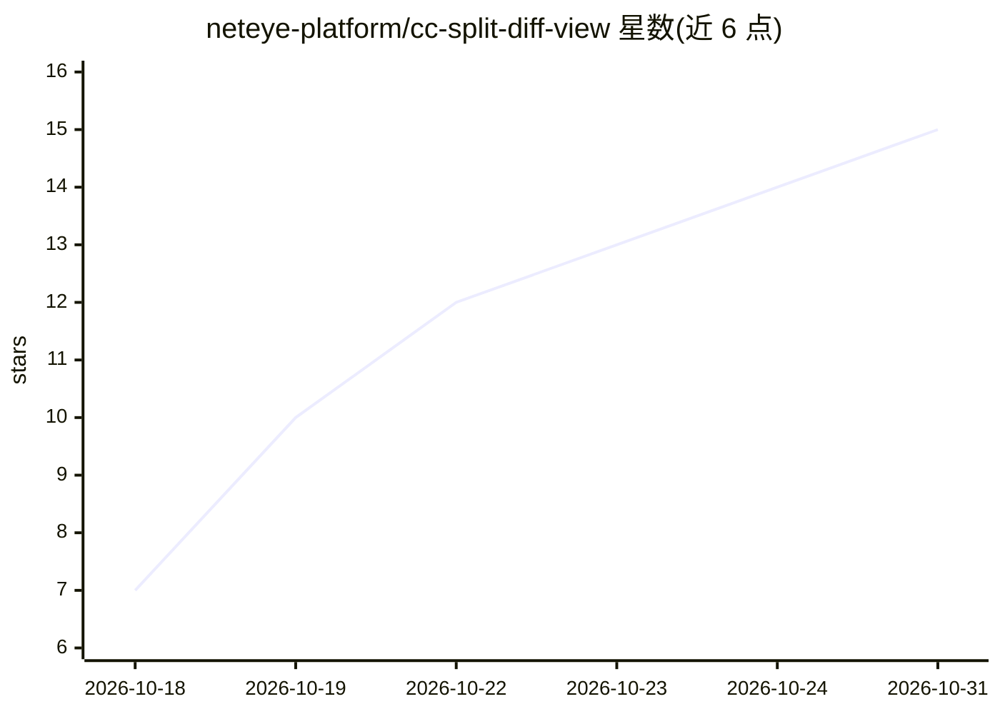

# neteye-platform/cc-split-diff-view

⭐ 15 · TypeScript · Apache-2.0 · 推送 2026-10-30 · [GitHub](https://github.com/neteye-platform/cc-split-diff-view) · 组织维护

**Claude Code 插件：以双栏并排形式显示 Edit/Write 的 diff**

一个 Claude Code mod（插件），将每次 Edit 与 Write 工具产生的 diff 从单列 -/+ 堆叠改为左右两栏并排显示：左栏为删除行、右栏为新增行，各自保留真实行号，hunk 之间折叠未变更行。颜色与语法高亮复用 Claude Code 自身的主题与高亮器。另提供 /diffsplit 命令，在单个窗格中查看工作目录对 HEAD 的全部未提交变更（含未跟踪文件），限制为前 100 个文件、每文件最多 500 行、总计约 1200 行。通过 claude plugin 命令安装，无需下载构建步骤。

## 筛选速览

| 维度 | 判定 | 备注 |
|---|---|---|
| AI 角色 | `ai-ecosystem` | LLM/agent 周边工具 |
| 许可风险 | `permissive` | Apache-2.0 |
| 部署形态 | `None` |  |
| 模型依赖 | — | README 未给出锁定关系 |
| 硬件要求 | — | 无带数字的原话,不猜 |
| 安装摩擦 | `low` | 无编译、无系统依赖或容器化 |
| 成熟度 | — | 结构信号不足 |

## 能力要点

- Edit/Write 的 diff 以左右两栏并排显示，保留真实行号
- /diffsplit 窗格查看全部未提交变更（含未跟踪文件）
- 颜色与高亮复用 Claude Code 自身主题与高亮器
- 无需构建，Claude Code 直接加载 TypeScript

## 适用场景

- 在 Claude Code 编辑代码时用双栏 diff 阅读变更
- 一次查看工作目录全部未提交改动
- 临时以 --plugin-dir 试用一晚而不正式安装

## 场景标签

 · 领域:开发者工具/终端 UI

## 证据(README 行号)

> L6: A Claude Code mod that
> L7: draws the diff of every `Edit` and `Write` in **two side-by-side columns**

## 星数曲线

2026-10-18 7 → 2026-10-31 15（+8）

---
*卡片 v1 · prompt 1.4 · 生成 2026-10-30 · 置信度 high · 依据 README sha `0c0970c35fc6` · [字段定义](../../DATASET.md)*
