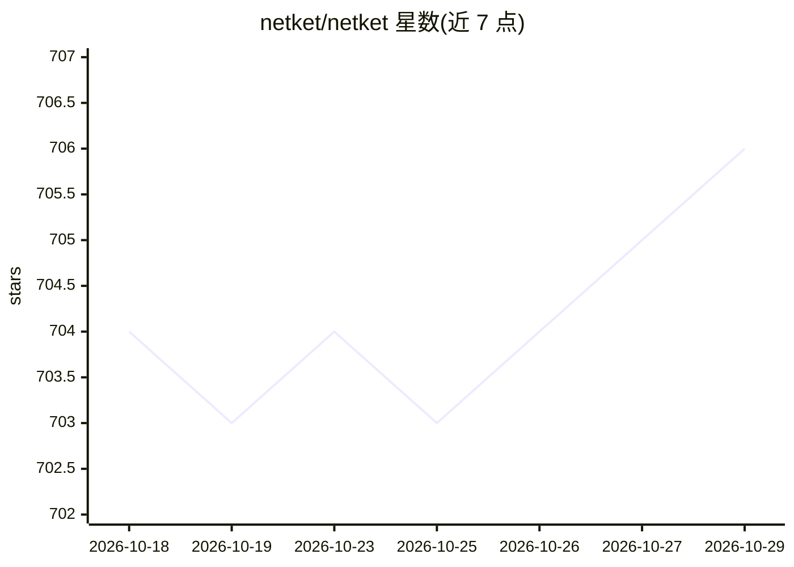

# netket/netket

⭐ 706 · Python · Apache-2.0 · 推送 2026-10-28 · [GitHub](https://github.com/netket/netket) · [官网](https://www.netket.org) · 组织维护

**基于 JAX 的多体量子系统机器学习 Python 库**

NetKet 是开源 Python 库，基于 JAX 构建，将神经网络与机器学习技术用于多体量子系统研究，涵盖神经量子态、哈密顿量与马尔可夫链蒙特卡洛方法等主题。提供文档、教程与示例脚本，可在本地或 Google Colaboratory 上运行。支持 macOS 与 Linux，需 Python 3.11+，推荐 pip 或 uv 安装，明确不建议用 conda（JAX 存在已知问题）；Linux 下可装 cuda 扩展启用 GPU 支持。NumFOCUS 附属项目，Apache 2.0 许可。

## 筛选速览

| 维度 | 判定 | 备注 |
|---|---|---|
| AI 角色 | `ai-native` | 本体是模型或模型工具 |
| 许可风险 | `permissive` | Apache-2.0 |
| 部署形态 | `library` | 以包/库形式分发 |
| 模型依赖 | — | README 未给出锁定关系 |
| 硬件要求 | — | 无带数字的原话,不猜 |
| 安装摩擦 | `medium` | 含编译或系统依赖之一 |
| 成熟度 | — | 结构信号不足 |

## 能力要点

- 基于 JAX 构建，面向多体量子系统的神经网络/机器学习方法
- 提供教程与可下载运行的示例脚本
- Linux 下通过 netket[cuda] 扩展支持 GPU
- NumFOCUS 附属项目，Apache 2.0 许可

## 适用场景

- 用神经量子态方法研究多体量子系统的基态与性质
- 运行示例脚本学习物理机器学习方法
- 在 Google Colab 上跟跑教程入门

## 场景标签

 · 领域:计算物理/量子多体

## 证据(README 行号)

> L11: NetKet is an open-source project delivering cutting-edge methods for the study of many-body quantum systems with ar
> L12: It is a Python library built on JAX.

## 星数曲线

2026-10-18 704 → 2026-10-29 706（+2）

---
*卡片 v1 · prompt 1.4 · 生成 2026-10-21 · 置信度 high · 依据 README sha `917e62756f57` · [字段定义](../../DATASET.md)*
