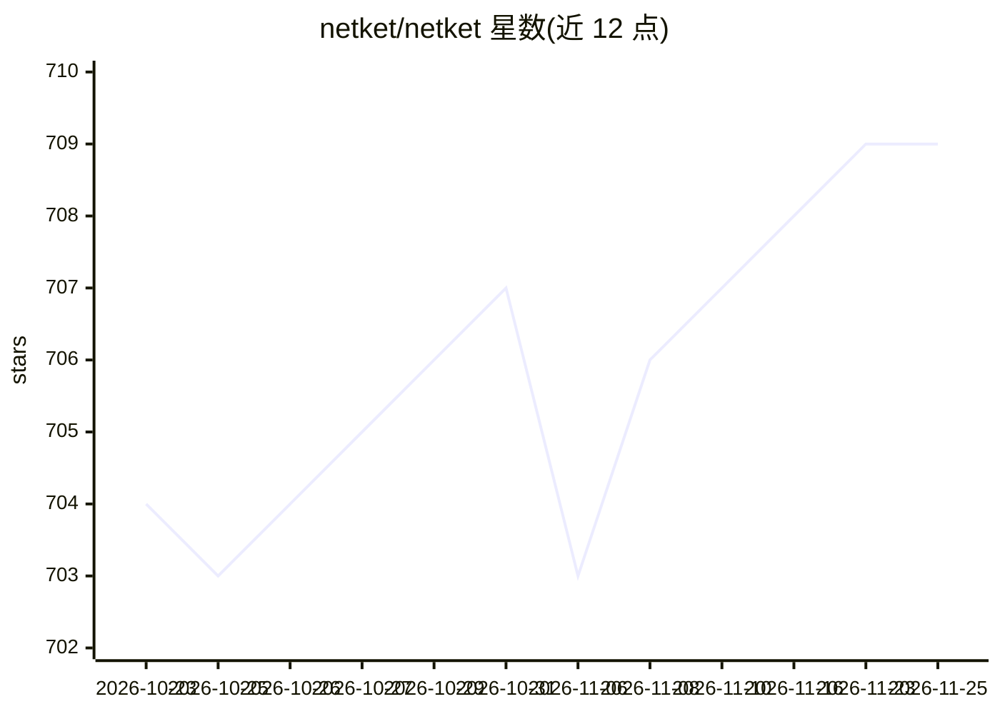

# netket/netket

⭐ 709 · Python · Apache-2.0 · 推送 2026-11-24 · [GitHub](https://github.com/netket/netket) · [官网](https://www.netket.org) · 组织维护

**面向科研的量子多体系统神经网络机器学习库**

NetKet 是一个 Python 库，基于 JAX 构建，提供用人工神经网络与机器学习方法研究多体量子系统的算法实现，属于神经量子态（NQS）方法的开源实现。面向量子物理研究人员，运行于 macOS 与 Linux，要求 Python 3.13 及以上，推荐用 pip 或 uv 安装，README 明确提示不要用 conda 安装以免 JAX 出问题；提供 GPU 支持（仅 Linux）的额外安装选项、文档、教程与示例脚本，项目为 NumFOCUS 附属项目，采用 Apache 2.0 许可。

## 筛选速览

| 维度 | 判定 | 备注 |
|---|---|---|
| AI 角色 | `ai-native` | 本体是模型或模型工具 |
| 许可风险 | `permissive` | Apache-2.0 |
| 部署形态 | `library` | 以包/库形式分发 |
| 模型依赖 | — | README 未给出锁定关系 |
| 硬件要求 | — | 无带数字的原话,不猜 |
| 安装摩擦 | `medium` | 含编译或系统依赖之一 |
| 成熟度 | — | 结构信号不足 |

## 能力要点

- 基于 JAX 的 Python 库，提供多体量子系统的神经网络算法
- 支持 GPU（仅 Linux，通过 netket[cuda] 安装）
- 提供教程、示例脚本与 Google Colaboratory 运行途径

## 适用场景

- 用神经量子态方法模拟多体量子系统
- 结合 JAX 做变分法量子物理科研计算
- 在 Google Colab 上运行教学教程

## 场景标签

`科研工具` · 领域:学习与行业

## 证据(README 行号)

> L11: NetKet is an open-source project delivering cutting-edge methods for the study of many-body quantum systems with ar
> L12: It is a Python library built on JAX.

## 星数曲线

2026-10-23 704 → 2026-11-25 709（+5）

---
*卡片 v1 · prompt 1.4 · 生成 2026-11-24 · 置信度 high · 依据 README sha `d0c9f7361ece` · [字段定义](../../DATASET.md)*
