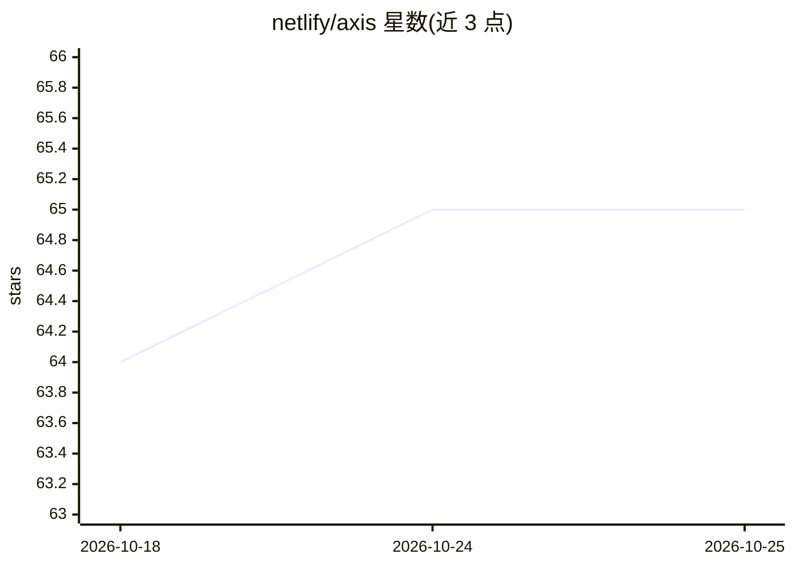

# netlify/axis

⭐ 65 · TypeScript · MIT · 推送 2026-10-16 · [GitHub](https://github.com/netlify/axis) · [官网](https://axis.run) · 组织维护

**评测 AI agent 使用服务体验的评分框架与工具**

Netlify 开源的 Agent 体验评测工具：给定场景、agent 与提示词，运行 agent、捕获完整转录并按四个独立维度（Goal Achievement、Environment、Service、Agent）输出评分。通过 npm 安装，以 axis.config.json 配置场景与 agent（如 claude-code），CLI 执行并写入报告；支持多次运行取中位数以降低随机波动，记录离散度与可靠性分数，提供 --compare-baseline 回归检测与可编程 API 供集成到测试运行器或 CI。运行次数必须为奇数（1-19），多次运行成本线性增长。

## 筛选速览

| 维度 | 判定 | 备注 |
|---|---|---|
| AI 角色 | `ai-ecosystem` | LLM/agent 周边工具 |
| 许可风险 | `permissive` | MIT |
| 部署形态 | `library` | 以包/库形式分发 |
| 模型依赖 | — | README 未给出锁定关系 |
| 硬件要求 | — | 无带数字的原话,不猜 |
| 安装摩擦 | `low` | 无编译、无系统依赖或容器化 |
| 成熟度 | — | 结构信号不足 |

## 能力要点

- 四维度评分：Goal Achievement / Environment / Service / Agent
- 多次运行取真实中位数代表运行，记录离散度与可靠性分数
- 崩溃运行不计入分数而计入可靠性，避免抖动伪装成低质量
- 提供 CLI 与编程 API，可集成到测试运行器与 CI 流水线

## 适用场景

- 度量网站或 API 对 AI agent 的可用性并生成评分报告
- 通过基线对比检测 agent 体验的回归
- 把 agent 体验评测嵌入既有 CI 或测试流程

## 场景标签

`模型评测` · 领域:评测与运维

## 证据(README 行号)

> L12: AXIS is an open source tooling and a scoring framework to measure how well services work for AI agents. Think Light
> L14: Give AXIS a scenario, an agent, and a prompt. It runs the agent, captures a full transcript, and produces a graded 

## 星数曲线

2026-10-18 64 → 2026-10-25 65（+1）

---
*卡片 v1 · prompt 1.4 · 生成 2026-10-24 · 置信度 high · 依据 README sha `b320baa8e859` · [字段定义](../../DATASET.md)*
