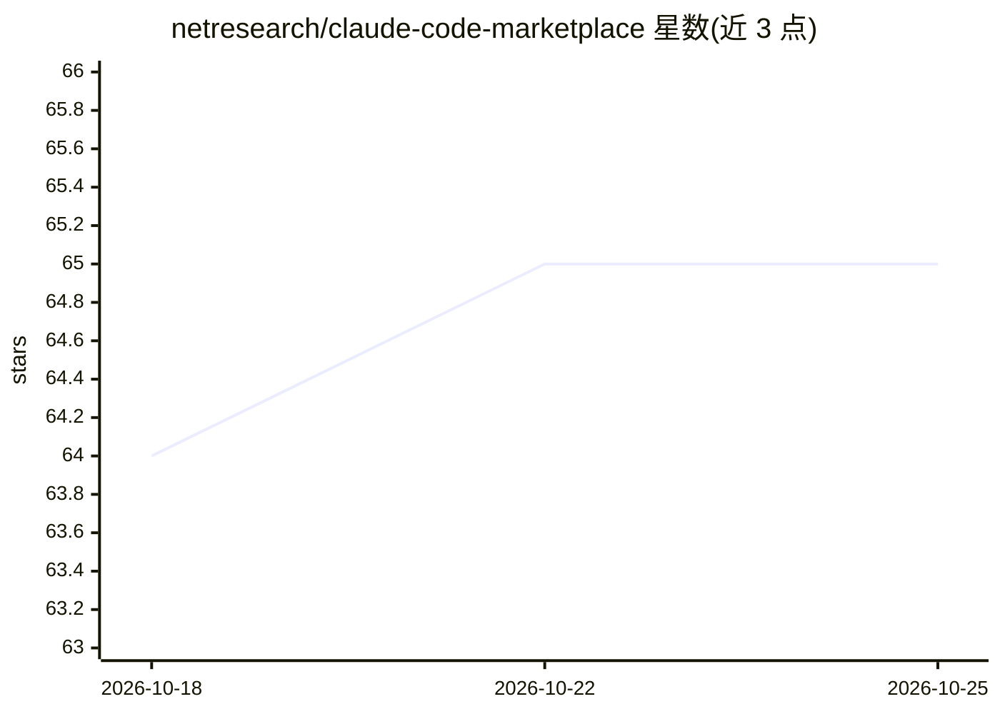

# netresearch/claude-code-marketplace

⭐ 65 · JavaScript · MIT · 推送 2026-10-22 · [GitHub](https://github.com/netresearch/claude-code-marketplace) · [官网](https://netresearch.github.io/claude-code-marketplace/) · 组织维护

**面向 AI 编程 agent 的技能市场：39 个可移植 Agent Skills 目录**

由 Netresearch DTT GmbH 维护的 Agent Skills 策展市场：收录 39 个覆盖 TYPO3、PHP、Go、Docker、Jira、安全与文档的技能，遵循 agentskills.io 开放标准与 Agent Plugins 1.0.0 打包格式，可移植到 Claude Code、Cursor、Copilot、Codex、Gemini CLI 等 30+ agent。仓库本身只含 marketplace.json 目录，安装时由客户端从各技能源仓库直接拉取。提供 Claude Code 插件市场命令与 npx 安装两种途径，另维护内部私有市场，并配套目录网站（英/德双语）。

## 筛选速览

| 维度 | 判定 | 备注 |
|---|---|---|
| AI 角色 | `ai-ecosystem` | LLM/agent 周边工具 |
| 许可风险 | `permissive` | MIT |
| 部署形态 | `self-host` | docker 或自建部署 |
| 模型依赖 | — | README 未给出锁定关系 |
| 硬件要求 | — | 无带数字的原话,不猜 |
| 安装摩擦 | `low` | 无编译、无系统依赖或容器化 |
| 成熟度 | — | 结构信号不足 |

## 能力要点

- 39 个技能覆盖 TYPO3、PHP、Go、Docker、Jira、安全等栈
- 遵循 Agent Skills 开放标准，兼容 30+ AI 编程 agent
- 源引用架构：marketplace.json 目录指向各技能独立仓库
- 配套英/德双语目录网站与治理流程（DCO、CodeQL、依赖审查）

## 适用场景

- 为 Claude Code 等 AI 编程 agent 安装 TYPO3/PHP 开发技能
- 按栈浏览并挑选可移植的 agent 技能
- 参考 marketplace.json 结构向市场添加自己的技能

## 场景标签

`精选清单` · 领域:学习与行业

## 证据(README 行号)

> L5: 39 curated Agent Skills for TYPO3, PHP, Go, Docker, Jira, security, and documentation — portable across Claude Code,
> L16: **Agentic Skills** are portable packages of procedural knowledge that work across any AI coding agent supporting th
> L18: Every listed repository is also an Agent Plugins 1.0.0 package: a `plugin.json` at the repository root plus the `sk

## 星数曲线

2026-10-18 64 → 2026-10-25 65（+1）

---
*卡片 v1 · prompt 1.4 · 生成 2026-10-24 · 置信度 mid · 依据 README sha `b4986b004573` · [字段定义](../../DATASET.md)*
