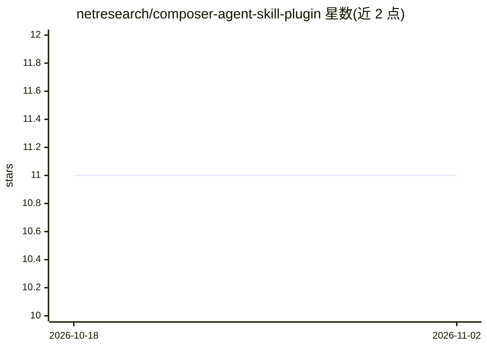

# netresearch/composer-agent-skill-plugin

⭐ 11 · PHP · MIT · 推送 2026-10-30 · [GitHub](https://github.com/netresearch/composer-agent-skill-plugin) · 组织维护

**PHP 项目的 Composer 插件：以依赖方式分发管理 AI agent 技能**

面向 PHP 开发者的 Composer 插件，把 AI agent 技能作为项目依赖管理：可通过 composer require 专用技能包（type: ai-agent-skill）、任何声明 extra.ai-agent-skill 的普通包，或从 GitHub / 项目内路径直接引入（经 composer.skills.lock 锁定）。安装时自动发现技能并生成兼容 openskills 的 AGENTS.md 索引供 agent 消费；内置信任模型，新包注册技能前需确认，非交互模式默认跳过，不自动信任。提供 list-skills、read-skill、skills:add 等命令及过期检查。

## 筛选速览

| 维度 | 判定 | 备注 |
|---|---|---|
| AI 角色 | `ai-ecosystem` | LLM/agent 周边工具 |
| 许可风险 | `permissive` | MIT |
| 部署形态 | `None` |  |
| 模型依赖 | — | README 未给出锁定关系 |
| 硬件要求 | — | 无带数字的原话,不猜 |
| 安装摩擦 | `low` | 无编译、无系统依赖或容器化 |
| 成熟度 | — | 结构信号不足 |

## 能力要点

- 三种技能引入途径（专用包 / extra 声明 / GitHub 与本地直连源）汇入同一发现与信任管线
- 自动生成兼容 openskills 的 AGENTS.md XML 技能索引
- 信任模型：allow-skills 持久化决策、glob 模式、CI 非交互模式不自动信任
- 直连源支持 git 标签上的 semver 约束与 composer.skills.lock 提交锁定

## 适用场景

- 在 PHP 项目中以依赖方式安装和版本管理 AI agent 技能
- 控制哪些包允许向项目注入 agent 技能指令
- CI 中用 skills:outdated --strict 检查技能是否落后于远端

## 场景标签

 · 领域:PHP 开发工具/AI agent 技能管理

## 证据(README 行号)

> L3: A Composer plugin for **AI agent skills** in PHP projects. Skills are **skill dependencies** of your repo: you decla
> L16: - **AGENTS.md generation**: Creates XML skill index compatible with openskills

## 星数曲线

2026-10-18 11 → 2026-11-02 11（+0）

---
*卡片 v1 · prompt 1.4 · 生成 2026-11-01 · 置信度 high · 依据 README sha `7780fed175a6` · [字段定义](../../DATASET.md)*
