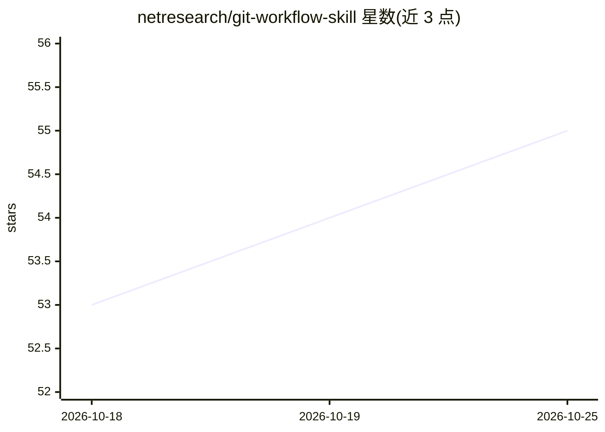

# netresearch/git-workflow-skill

⭐ 55 · Shell · NOASSERTION · 推送 2026-10-24 · [GitHub](https://github.com/netresearch/git-workflow-skill) · 组织维护

**给 AI agent 的 Git 工作流最佳实践技能包**

遵循 Anthropic 发起的 Agent Skills 开放标准的技能包，向 Claude Code、Cursor、GitHub Copilot 等兼容 agent 提供程序性知识：分支策略（Git Flow/GitHub Flow/trunk-based）、Conventional Commits 规范、PR 协作流程、CI/CD 集成、Git hooks 与高级操作。附带 /pr-finish 命令驱动 PR 到合并完成，并自带 hooks 与 commands 文件；npx skills 安装路径不覆盖 hooks/commands。提供 marketplace、git clone、npx、release、Composer、npm 六种安装方式，由 Netresearch DTT GmbH 维护，采用 split licensing 并声明组织级治理与安全检查流程。

## 筛选速览

| 维度 | 判定 | 备注 |
|---|---|---|
| AI 角色 | `ai-knowledge` | 知识聚合/清单类 |
| 许可风险 | `none` | NOASSERTION |
| 部署形态 | `library` | 以包/库形式分发 |
| 模型依赖 | — | README 未给出锁定关系 |
| 硬件要求 | — | 无带数字的原话,不猜 |
| 安装摩擦 | `low` | 无编译、无系统依赖或容器化 |
| 成熟度 | — | 结构信号不足 |

## 能力要点

- 覆盖分支策略、Conventional Commits、PR 流程、CI/CD 集成与 Git hooks 的知识包
- 附带 /pr-finish 命令自动驱动 PR 到合并完成
- 兼容 Claude Code、Cursor、GitHub Copilot 等支持 Agent Skills 规范的平台
- 六种安装途径（marketplace/git clone/npx/release/Composer/npm）

## 适用场景

- 让 AI agent 按最佳实践搭建 Git Flow 或 trunk-based 分支策略
- 让 agent 实施 Conventional Commits 与语义化版本
- 让 agent 自动处理 PR：rebase、修复 CI、回复评审直至合并

## 场景标签

`提示工程` · 领域:Agent 开发

## 证据(README 行号)

> L7: This is an **Agent Skill** following the open standard originally developed by Anthropic and released for cross-plat
> L15: > Skills are portable packages of procedural knowledge that work across any AI agent supporting the Agent Skills sp
> L3: Expert patterns for Git version control workflows including branching strategies, commit conventions, collaborative 

## 星数曲线

2026-10-18 53 → 2026-10-25 55（+2）

---
*卡片 v1 · prompt 1.4 · 生成 2026-10-24 · 置信度 high · 依据 README sha `6c71f577d508` · [字段定义](../../DATASET.md)*
