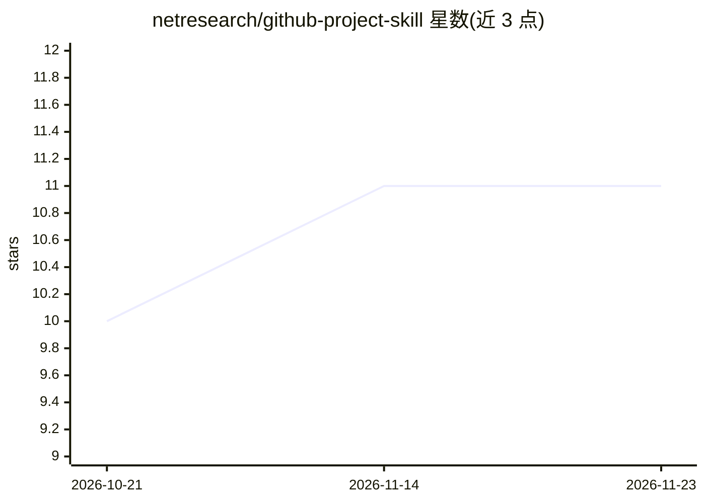

# netresearch/github-project-skill

⭐ 11 · Shell · NOASSERTION · 推送 2026-11-22 · [GitHub](https://github.com/netresearch/github-project-skill) · 组织维护

**给 AI agent 用的 GitHub 仓库配置与平台功能技能包**

以 Agent Skills 开放标准打包的流程性知识库，内容为 GitHub 平台配置模式：分支保护、规则集（Rulesets）、合并队列、CODEOWNERS、子 issue 层级、Dependabot/Renovate 自动合并、PR 评论解决工作流与 master→main 迁移步骤，附初始化与校验脚本（init-branch-protection.sh、verify-github-project.sh）。明确不覆盖 CI/CD 与语言工具链。可通过 Claude Code 插件市场、skills 目录、npx、Composer、npm 多途径安装，供支持该规范的 agent 加载。

## 筛选速览

| 维度 | 判定 | 备注 |
|---|---|---|
| AI 角色 | `ai-knowledge` | 知识聚合/清单类 |
| 许可风险 | `none` | NOASSERTION |
| 部署形态 | `library` | 以包/库形式分发 |
| 模型依赖 | — | README 未给出锁定关系 |
| 硬件要求 | — | 无带数字的原话,不猜 |
| 安装摩擦 | `low` | 无编译、无系统依赖或容器化 |
| 成熟度 | — | 结构信号不足 |

## 能力要点

- 遵循 Anthropic 发起的 Agent Skills 开放标准，兼容 Claude Code/Cursor/GitHub Copilot 等多个 agent
- 覆盖分支保护、Rulesets 对齐、合并队列 GraphQL mutation 等配置与排障流程
- 提供 init-branch-protection.sh 初始化与 verify-github-project.sh 校验脚本
- 通过插件市场/npx/Composer/npm/git clone 多途径分发

## 适用场景

- 让 AI 助手代为完成新仓库的分支保护与规则集配置
- 排查 PR 无法合并、自动合并失败、规则集冲突等问题
- 把 master 默认分支迁移为 main 的操作指引

## 场景标签

`提示工程` · 领域:Agent 开发

## 证据(README 行号)

> L19: This is an **Agent Skill** following the open standard originally developed by Anthropic and released for cross-pla
> L27: > Skills are portable packages of procedural knowledge that work across any AI agent supporting the Agent Skills sp
> L8: GitHub platform configuration and repository management patterns. This skill focuses exclusively on **GitHub-specifi

## 星数曲线

2026-10-21 10 → 2026-11-23 11（+1）

---
*卡片 v1 · prompt 1.4 · 生成 2026-11-18 · 置信度 high · 依据 README sha `bac6dc4bccd1` · [字段定义](../../DATASET.md)*
