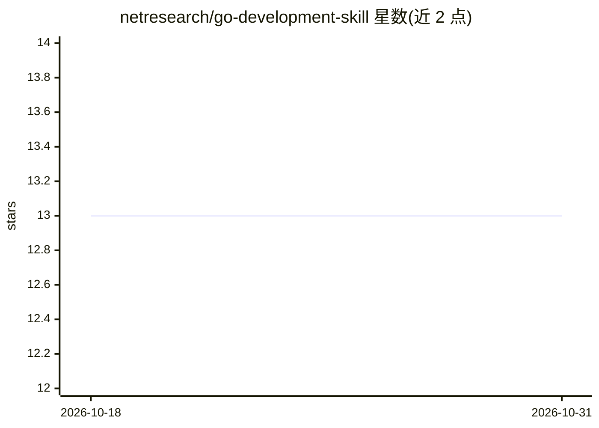

# netresearch/go-development-skill

⭐ 13 · Shell · NOASSERTION · 推送 2026-10-30 · [GitHub](https://github.com/netresearch/go-development-skill) · 组织维护

**面向 AI agent 的 Go 企业级开发技能包（SKILL.md 标准）**

遵循 Anthropic 发起的 Agent Skills 开放标准的技能包，向 Claude Code、Cursor、GitHub Copilot 等兼容 agent 注入生产级 Go 开发模式知识：涵盖 go-cron 调度、重试/熔断/超时韧性封装、Docker 客户端优化、LDAP/AD 集成、构建标签测试隔离与 Prometheus 可观测性。自动在编写 Go 服务、任务调度、Docker/LDAP 集成等场景触发。提供 marketplace 插件、git clone 到 skills 目录、npx skills add、Composer 等多种安装方式；仓库自带离线行为测试与 PR 校验流程，采用 split licensing。

## 筛选速览

| 维度 | 判定 | 备注 |
|---|---|---|
| AI 角色 | `ai-ecosystem` | LLM/agent 周边工具 |
| 许可风险 | `none` | NOASSERTION |
| 部署形态 | `library` | 以包/库形式分发 |
| 模型依赖 | — | README 未给出锁定关系 |
| 硬件要求 | — | 无带数字的原话,不猜 |
| 安装摩擦 | `low` | 无编译、无系统依赖或容器化 |
| 成熟度 | — | 结构信号不足 |

## 能力要点

- 覆盖 go-cron 调度、韧性封装、Docker/LDAP 集成、测试策略与可观测性的模式知识
- 兼容 Agent Skills 开放标准，支持 Claude Code/Cursor/CitHub Copilot 等
- 附带 verify-go-project.sh 等校验脚本与离线行为测试
- 提供 marketplace、git clone、npx、Composer 等多种安装途径

## 适用场景

- 让 AI agent 按企业级模式编写 Go 服务与 CLI 应用
- 实现带重试/熔断的任务调度或 Docker/LDAP 集成
- 为 Go 项目搭建构建标签隔离的测试与质量门禁

## 场景标签

`提示工程` · 领域:Agent 开发

## 证据(README 行号)

> L7: This is an **Agent Skill** following the open standard originally developed by Anthropic and released for cross-plat
> L15: > Skills are portable packages of procedural knowledge that work across any AI agent supporting the Agent Skills sp

## 星数曲线

2026-10-18 13 → 2026-10-31 13（+0）

---
*卡片 v1 · prompt 1.4 · 生成 2026-10-31 · 置信度 high · 依据 README sha `f2c743ba2be8` · [字段定义](../../DATASET.md)*
