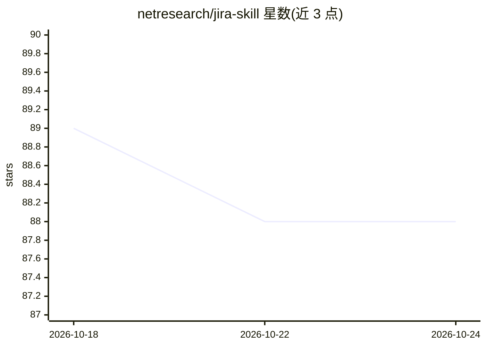

# netresearch/jira-skill

⭐ 89 · Python · NOASSERTION · 推送 2026-10-24 · [GitHub](https://github.com/netresearch/jira-skill) · 组织维护

**面向 Claude Code 等 AI agent 的 Jira 集成技能插件**

Netresearch 维护的 Agent Skills 插件，含两个技能：jira-communication 通过 Python CLI 脚本操作 Jira API（问题查询/创建/更新、评论、工作日志、Sprint、看板、附件、字段、用户、链接等），jira-syntax 提供 Jira wiki 标记语法、模板与校验。脚本通过 Bash 调用，无 MCP 开销、无 Docker，支持 Jira Server/DC 与 Cloud。兼容 Claude Code、Cursor、GitHub Copilot 等 Agent Skills 规范平台，可通过 marketplace、git clone、npx、Composer、npm 等多种方式安装；npx 方式不安装 hooks。

## 筛选速览

| 维度 | 判定 | 备注 |
|---|---|---|
| AI 角色 | `ai-ecosystem` | LLM/agent 周边工具 |
| 许可风险 | `none` | NOASSERTION |
| 部署形态 | `library` | 以包/库形式分发 |
| 模型依赖 | — | README 未给出锁定关系 |
| 硬件要求 | — | 无带数字的原话,不猜 |
| 安装摩擦 | `low` | 无编译、无系统依赖或容器化 |
| 成熟度 | — | 结构信号不足 |

## 能力要点

- jira-communication 技能以 Python CLI 覆盖 Jira 常用 API 操作（问题/工作日志/Sprint/看板/评论/链接等）
- 脚本经 Bash 调用，无 MCP 工具描述加载与 Docker 容器启动
- 同时支持 Jira Server/DC 与 Cloud 部署
- 遵循 Anthropic 发起的 Agent Skills 开放标准，兼容 Claude Code/Cursor/GitHub Copilot 等平台

## 适用场景

- 让 Claude Code 等 AI agent 在对话中查询和操作 Jira 问题
- 开发流程中通过 agent 记录工作日志、管理 Sprint 与看板
- 编写或校验 Jira wiki 标记格式的评论与描述

## 场景标签

 · 领域:项目管理/AI 工具集成

## 证据(README 行号)

> L7: A Claude Code plugin providing comprehensive Jira integration through two specialized skills.
> L16: Each skill has its own `SKILL.md` with trigger conditions and usage instructions. Claude Code auto-discovers and ac
> L20: The skills contained in this plugin follow the Agent Skills open standard originally developed by Anthropic and rel

## 星数曲线

2026-10-18 89 → 2026-10-24 88（-1）

---
*卡片 v1 · prompt 1.4 · 生成 2026-10-23 · 置信度 mid · 依据 README sha `3b6a9253d5ce` · [字段定义](../../DATASET.md)*
