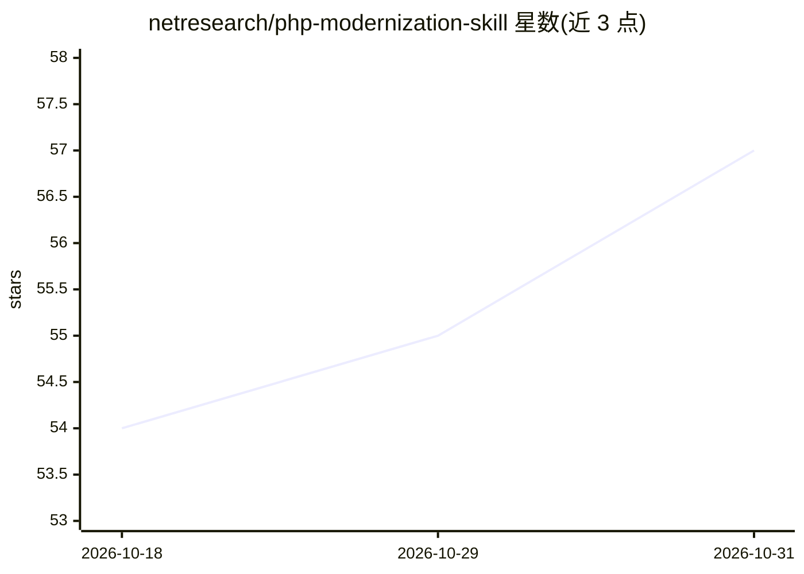

# netresearch/php-modernization-skill

⭐ 57 · Python · NOASSERTION · 推送 2026-10-30 · [GitHub](https://github.com/netresearch/php-modernization-skill) · 组织维护

**PHP 8.x 现代化的 Agent Skill：类型安全与静态分析工具契约**

面向 Claude Code、Cursor、GitHub Copilot 等 Agent Skills 兼容代理的技能包，提供 PHP 7.x→8.0–8.5 现代化模式（strict types、DTO/Value Object、backed enums、property hooks、pipe 运算符）、PSR/PER-CS 合规与 PHPStan/Rector/PHP-CS-Fixer/PHPat/Infection 静态分析工具栈指引。核心机制是 agent contract：附 Python 验证器、编排器与剖析器，输出 JSON/SARIF/JUnit 结构化报告与机器可读 agent_actions 建议，含 5 条硬性护栏与 4 种项目原型检测。经 Claude Code marketplace、npx、composer 或 git clone 安装。

## 筛选速览

| 维度 | 判定 | 备注 |
|---|---|---|
| AI 角色 | `ai-ecosystem` | LLM/agent 周边工具 |
| 许可风险 | `none` | NOASSERTION |
| 部署形态 | `library` | 以包/库形式分发 |
| 模型依赖 | — | README 未给出锁定关系 |
| 硬件要求 | — | 无带数字的原话,不猜 |
| 安装摩擦 | `low` | 无编译、无系统依赖或容器化 |
| 成熟度 | — | 结构信号不足 |

## 能力要点

- PHP 8.0–8.5 特性覆盖，含 8.4/8.5 专门参考
- Python 验证器输出 JSON/SARIF 2.1.0/JUnit XML 结构化报告与 agent_actions 建议
- 5 条硬性护栏（如 Rector 必须先 dry-run）
- 支持 4 种项目原型检测（generic-composer/typo3-extension/symfony-app/monorepo-package）

## 适用场景

- 让 AI 代理把旧 PHP 项目升级到 PHP 8.x 并引入严格类型
- 为 PHP 项目配置 PHPStan/Rector/PHP-CS-Fixer/PHPat 静态分析栈
- 在 CI 中运行验证器并以 SARIF 上传 GitHub 代码扫描

## 场景标签

`编码 Agent` · 领域:编码与开发

## 证据(README 行号)

> L3: Expert patterns for modernizing PHP applications to PHP 8.x with type safety, PSR / PER-CS compliance, static-analys
> L7: This is an **Agent Skill** following the open standard originally developed by Anthropic and released for cross-plat
> L16: Skills are portable packages of procedural knowledge that work across any AI agent supporting the Agent Skills spec

## 星数曲线

2026-10-18 54 → 2026-10-31 57（+3）

---
*卡片 v1 · prompt 1.4 · 生成 2026-10-24 · 置信度 high · 依据 README sha `47402e0a69b8` · [字段定义](../../DATASET.md)*
