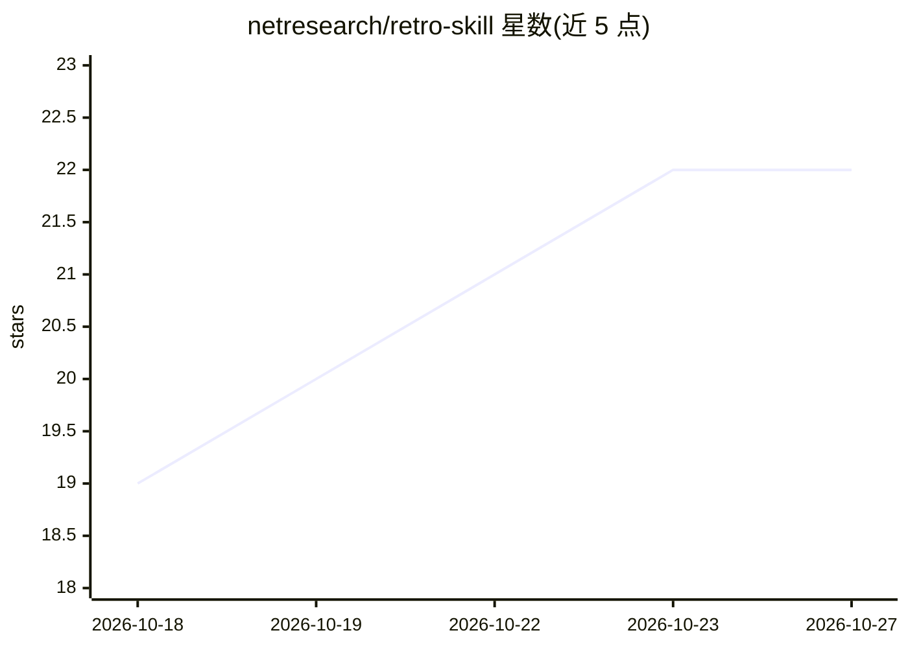

# netresearch/retro-skill

⭐ 22 · Python · NOASSERTION · 推送 2026-10-25 · [GitHub](https://github.com/netresearch/retro-skill) · [官网](https://github.com/netresearch/retro-skill) · 组织维护

**Claude Code 会话复盘插件：检测摩擦并把经验写入正确去处**

以 Claude Code 插件形式提供的会话回顾工具：会话结束后 `/retro` 读取对话转录，先经 20 个确定性信号（A1–A20）的机械预筛，再由 LLM 增加 20 个推断信号做富化与分类，将每条摩擦发现路由到七个目的地之一（canonical-source PR、个人规则、项目规则、技能更新 PR、新技能、checkpoint、harness 构件），每次写入均需逐条人工批准，单次最多返回 10 条建议。提供 Sweep/Spotlight/Outcome/Audit/Promote/Done 六种模式。依赖 Claude Code、uv、jq、gh/glab、git。

## 筛选速览

| 维度 | 判定 | 备注 |
|---|---|---|
| AI 角色 | `ai-ecosystem` | LLM/agent 周边工具 |
| 许可风险 | `permissive` | NOASSERTION |
| 部署形态 | `library` | 以包/库形式分发 |
| 模型依赖 | locked-api |  |
| 硬件要求 | — | 无带数字的原话,不猜 |
| 安装摩擦 | `low` | 无编译、无系统依赖或容器化 |
| 成熟度 | — | 结构信号不足 |

## 能力要点

- 机械预筛（20 信号）+ LLM 富化（20 信号）+ 可选跨会话层（6 信号）的分层流水线
- 七种目的地的权威优先分类，逐条批准、无静默写入
- 六种模式：Sweep/Spotlight/Outcome/Audit/Promote/Done
- PR 使用 Conventional Commits 与 DCO sign-off，目标为源仓库而非插件缓存

## 适用场景

- 会话结束后复盘工具报错与重复失误，把经验沉淀为规则或技能 PR
- 定期做跨会话架构审计与成果回放（Outcome/Audit）
- 整理堆积的项目本地记忆并上移到全局规则（Promote）

## 场景标签

`提示工程` `Agent 记忆` · 领域:Agent 开发

## 证据(README 行号)

> L3: **LLM-driven session retrospection for Claude Code agents.** After a session, `/retro` reads the conversation transc
> L7: Claude Code plugin
> L15: `/retro` analyzes the current Claude Code session directly from the conversation transcript — no continuous backgro

## 星数曲线

2026-10-18 19 → 2026-10-27 22（+3）

---
*卡片 v1 · prompt 1.4 · 生成 2026-10-27 · 置信度 mid · 依据 README sha `70fb7844b229` · [字段定义](../../DATASET.md)*
