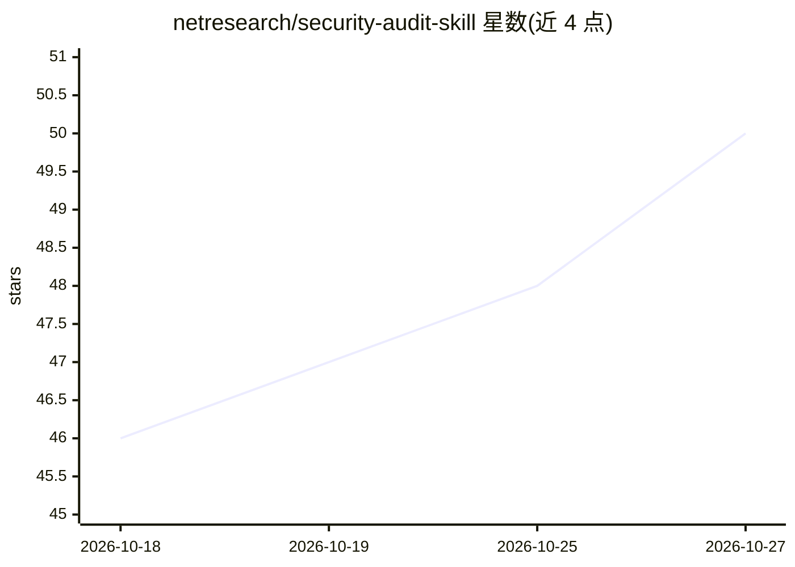

# netresearch/security-audit-skill

⭐ 50 · Shell · NOASSERTION · 推送 2026-10-26 · [GitHub](https://github.com/netresearch/security-audit-skill) · 组织维护

**给 AI agent 的 PHP/Web 安全审计技能包：OWASP/CWE 模式与 80+ 检查点**

遵循 Anthropic 开放的 Agent Skills 标准的技能包，为 Claude Code、Cursor、GitHub Copilot 等 agent 注入安全审计能力：覆盖 XXE/SQL 注入/XSS/CSRF 等 15 类漏洞检测、CVSS v3.1/v4.0 风险评分、OWASP Top 10 与 CWE Top 25 (2025) 合规，以及 PHP/TYPO3 深度扫描的 80+ 自动化检查点。附带 PreToolUse 钩子拦截危险命令，审计脚本依赖 bash 4+ 与 GNU grep，支持 marketplace、git clone、npx、Composer、npm 五种安装途径，但 npx 途径不装 hooks。由 Netresearch DTT GmbH 维护，采用拆分许可。

## 筛选速览

| 维度 | 判定 | 备注 |
|---|---|---|
| AI 角色 | `ai-ecosystem` | LLM/agent 周边工具 |
| 许可风险 | `none` | NOASSERTION |
| 部署形态 | `library` | 以包/库形式分发 |
| 模型依赖 | locked-api |  |
| 硬件要求 | — | 无带数字的原话,不猜 |
| 安装摩擦 | `low` | 无编译、无系统依赖或容器化 |
| 成熟度 | — | 结构信号不足 |

## 能力要点

- 15 类漏洞检测模式与 41 份参考指南
- CVSS v3.1/v4.0 评分方法与风险矩阵
- PHP/TYPO3 深度扫描 80+ 自动化检查点
- PreToolUse 钩子对危险命令给出警告

## 适用场景

- 让 Claude Code 等 agent 对 PHP/TYPO3 项目做安全审计
- 按 OWASP Top 10 / CWE Top 25 检查代码并给出 CVSS 评分
- 在编码过程中通过钩子拦截不安全的命令与模式

## 场景标签

`代码审查` · 领域:编码与开发

## 证据(README 行号)

> L7: This is an **Agent Skill** following the open standard originally developed by Anthropic and released for cross-plat
> L15: > Skills are portable packages of procedural knowledge that work across any AI agent supporting the Agent Skills sp

## 星数曲线

2026-10-18 46 → 2026-10-27 50（+4）

---
*卡片 v1 · prompt 1.4 · 生成 2026-10-25 · 置信度 high · 依据 README sha `9f281b42a313` · [字段定义](../../DATASET.md)*
