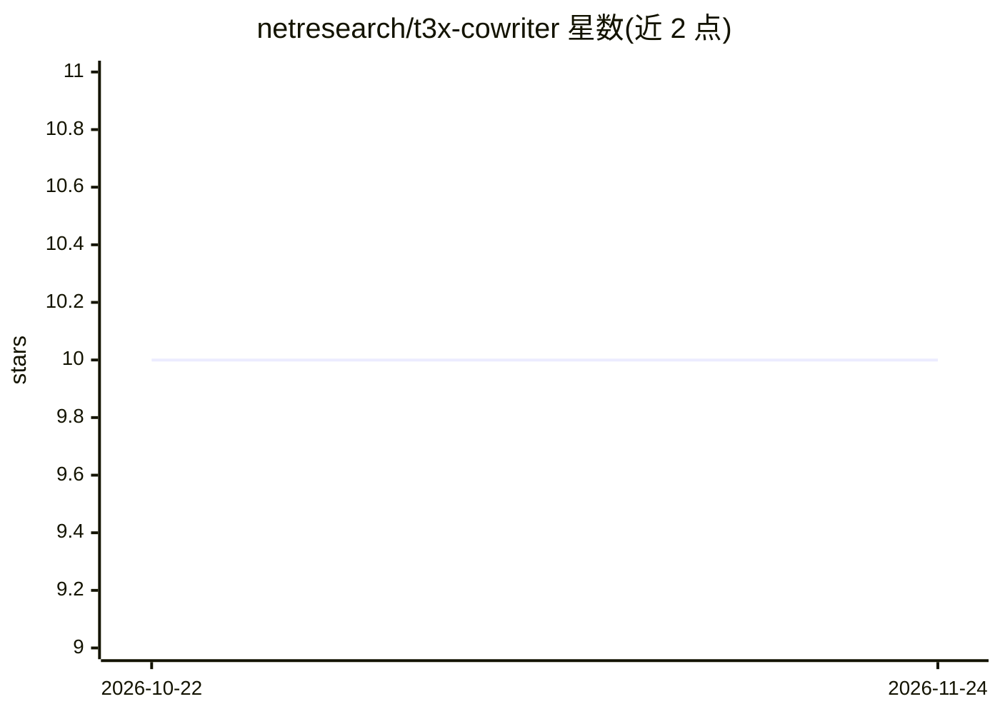

# netresearch/t3x-cowriter

⭐ 10 · PHP · GPL-3.0 · 推送 2026-11-24 · [GitHub](https://github.com/netresearch/t3x-cowriter) · 组织维护

**为 TYPO3 编辑者提供 CKEditor 内 AI 写作助手的扩展**

TYPO3 CMS 扩展，在 CKEditor 中提供 AI 写作对话框：改进/摘要/扩写/纠错/翻译等预设任务、图片生成替代文本、10+ 语言翻译、字段级 AI 建议与行内续写（部分默认关闭，需扩展设置开启）。通过 nr-llm 扩展接入多种 LLM 提供商，请求经 TYPO3 后端代理，API key 加密存储、限流与内容净化。要求 PHP 8.2+ 与 TYPO3 v13/v14，Composer 安装。

## 筛选速览

| 维度 | 判定 | 备注 |
|---|---|---|
| AI 角色 | `ai-native` | 本体是模型或模型工具 |
| 许可风险 | `viral` | GPL-3.0 |
| 部署形态 | `None` |  |
| 模型依赖 | — | README 未给出锁定关系 |
| 硬件要求 | — | 无带数字的原话,不猜 |
| 安装摩擦 | `low` | 无编译、无系统依赖或容器化 |
| 成熟度 | — | 结构信号不足 |

## 能力要点

- CKEditor 工具栏集成六大组件：主对话框、视觉、翻译、模板、图像生成、行内建议开关
- 经 nr-llm 抽象层支持多 LLM 提供商（OpenAI、Claude、Gemini 等）
- API key 加密存储于后端，前端不可见；SSE 流式输出与限流（20 次/分钟）
- 字段建议覆盖页面标题、SEO、Open Graph 等字段并可一次批量生成

## 适用场景

- 站点编辑者在后台改写、摘要、纠错页面文案
- 为图片批量生成描述性 alt text
- 将选中内容翻译为英/德等 10+ 种语言
- 为 SEO 与社交分享字段批量生成建议值

## 场景标签

`AI 写作` · 领域:内容生成

## 证据(README 行号)

> L25: AI-powered content assistant for TYPO3 CKEditor - write better content with help from AI.
> L31: - **Task-based dialog**: Select from predefined tasks (Improve, Summarize, Extend, Fix Grammar, Translate) with res
> L43: - **Multi-Provider Support**: Works with all LLM providers supported by nr-llm (OpenAI, Claude, Gemini, etc.)

## 星数曲线

2026-10-22 10 → 2026-11-24 10（+0）

---
*卡片 v1 · prompt 1.4 · 生成 2026-11-19 · 置信度 high · 依据 README sha `de1413e09d0d` · [字段定义](../../DATASET.md)*
